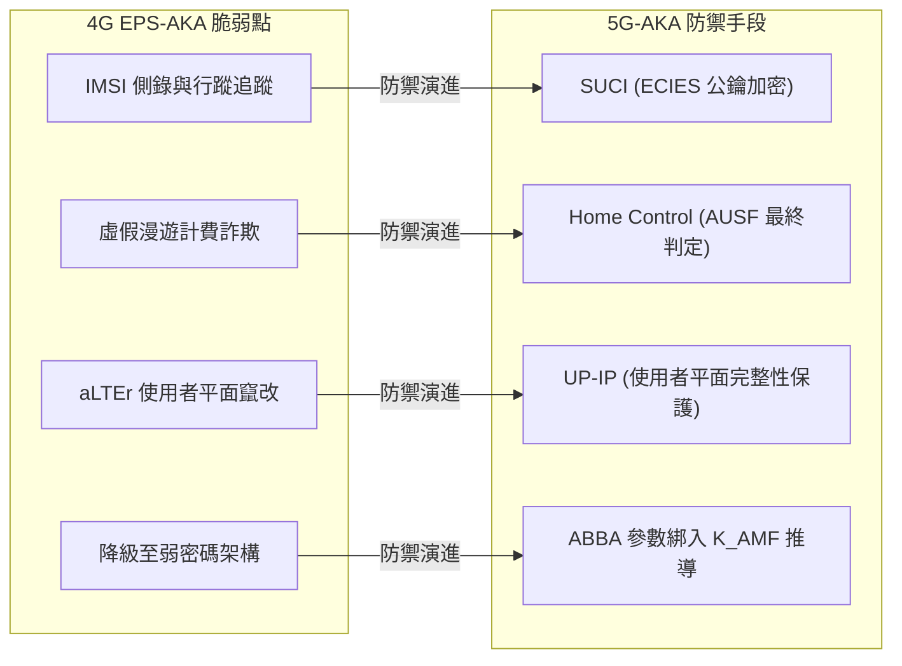

# 4G EPS-AKA 與 5G-AKA 認證安全橫向對比 (4G EPS-AKA vs 5G-AKA)

> **一句話核心差異**：5G-AKA 徹底翻轉了 4G EPS-AKA「拜訪網路全權說了算、用戶身分空中裸奔」的脆弱信任模型，確立了**歸屬網路最終裁決權（Home Control）**、**以公鑰加密保護用戶隱私（SUCI）**，並透過**服務網路名稱（$SN\text{-}name$）全域綁定**阻斷跨網偽冒 [3GPP TS 33.501 Rel-18 §6.1.3.2; 講義: 5G安全_TS33501-Week4.pdf, p.7, 19]。

---

## 📊 核心維度全覽對照表

| 分析維度 | 4G EPS-AKA (TS 33.401) | 5G-AKA (TS 33.501 Rel-18) | 安全演進意義 [講義 p.19] |
|---|---|---|---|
| **初始身分傳輸** | **明文 [[SUPI\|IMSI]] 傳送** （空中介面無保護裸奔） | **[[SUCI]]（ECIES 非對稱公鑰加密）** （空中介面僅傳臨時密文） | 徹底瓦解傳統 IMSI Catcher 在未認證階段竊取永久身分的攻擊路徑。 |
| **認證成敗判定權** | **拜訪網路 MME 自行判定** （拿到向量後自行比對即結案） | **歸屬網路 [[AUSF]] 最終判定** （$RES^*$ 必須送回母國比對） | **Home Control**：拜訪網路無法自行偽造認證成功記錄，防範跨國漫遊計費詐欺。 |
| **歸屬網路知情權** | **完全不知情** （HSS 不知道認證是否真的成功） | **每次認證結果必回傳登錄** （AUSF 以 Nudm_UEAuthentication_ResultConfirmation 通知 [[UDM]]，§6.1.4.1a） | 電信商對用戶在全球的接入狀態擁有 100% 知情權與監管能力。 |
| **回應與服務網綁定** | **未綁定服務網路** （$RES$ 未納入 Serving Network ID） | **強制綁定 $SN\text{-}name$** （$RES^* = KDF(CK \parallel IK, SN\text{-}name, \dots)$） | 在 A 國取得的終端回應，無法被惡意中繼挪到 B 國重用。 |
| **頂層錨點金鑰** | **$K_{ASME}$（直接交給 MME）** （歸屬網路不保留對應衍生密鑰） | **$K_{SEAF}$（交給 SEAF）** 另有 **$K_{AUSF}$ 留存於歸屬網路** | 金鑰分離更徹底，歸屬網路可用 $K_{AUSF}$ 保護後續漫遊導引（SoR）等控制服務。 |
| **使用者平面完整性** | **完全不支援（僅有加密）** （易受位元翻轉攻擊如 aLTEr） | **可依 Policy 逐 DRB 啟用** （支援 128-NIA 完整性驗證） | 終結傳輸層封包竄改風險（如 DNS 劫持），實現真正的全鏈路資料完整性。 |
| **抗架構降級機制** | **無專屬防禦機制** | **$ABBA$ 參數直接綁入金鑰推導** （$K_{AMF} = KDF(K_{SEAF}, SUPI, ABBA)$） | 防止中間人誘使雙方退回較弱的安全設定或舊架構。 |
| **非 SIM 憑證擴充** | **不支援**（強制綁定 USIM 卡） | **原生支援**（SNPN 專網可用 EAP-TLS） | 大幅提升專網、IoT 與非公眾網路的部署彈性。 |

---

## 🔍 三大結構性變革深度剖析

### 1. 歸屬網路控制權（Home Control）的確立
- **4G 缺陷場景**：在 4G EPS-AKA 流程中，歸屬網路（HSS）在核發認證向量 $(RAND, AUTN, XRES, K_{ASME})$ 後，便退出了認證流程。拜訪網路（MME）收到終端回傳的 $RES$ 後，由 MME 在本地比對 $RES == XRES$。  
  > ⚠️ **漫遊詐欺漏洞**：不肖拜訪網路只需向 HSS 索取向量，無需終端真正出現，即可在本地宣稱認證成功並向歸屬電信商請款結算（Roaming Fraud）[講義: 5G安全_TS33501-Week4.pdf, p.7]。
- **5G 解法**：5G 將驗證體系拆為兩層：
  - 拜訪網 [[SEAF]] 只拿到雜湊遮罩 $HXRES^*$，僅具備初步篩檢錯誤回應的能力（Efficiency）。
  - 終端計算的 $RES^*$ 必須原封不動送交歸屬網 [[AUSF]]，與 $XRES^*$ 進行位元比對（Authority）。**只有 AUSF 裁定成功，本次認證才具效力** [TS 33.501 Rel-18 §6.1.3.2]。

### 2. 身分識別碼由「裸奔」到「端對端公鑰隱蔽」
- **4G 缺陷場景**：手機開機或跨區漫遊時，基地台送出 `Identity Request`，終端以明文回傳 `IMSI`。攻擊者只要架設一台發射功率高於周邊合法基地台的設備（IMSI Catcher），手機就會主動接入並交出 IMSI，攻擊者即可在該地區長期追蹤用戶 [講義: 5G安全_TS33501-Week4.pdf, p.6–7]。
- **5G 解法**：終端在空中介面僅傳送 [[SUCI]]。SUCI 採用 [[ECIES]] 非對稱加密架構，以預先寫入 USIM 的歸屬網路公鑰加密用戶號碼（MSIN）。全網只有歸屬網路內的 [[SIDF]] 掌握私鑰能夠解密，徹底終結空中側錄攻擊 [TS 33.501 Rel-18 §6.12.2, Annex C]。

### 3. 全局情境綁定（Context & SN-name Binding）
- **4G 缺陷場景**：4G 的認證回應 $RES$ 僅依賴密鑰與亂數計算，未綁定拜訪網路身分。
- **5G 解法**：5G-AKA 強制將服務網路官方名稱 **$SN\text{-}name$** 納入推導：
  $$RES^* = KDF(CK \parallel IK, SN\text{-}name, RAND, RES)$$
  $$K_{SEAF} = KDF(K_{AUSF}, SN\text{-}name)$$
  這意味著，終端產出的認證回應與金鑰在密碼學上嚴格「鎖死」於當前的服務網路，攻擊者即便截獲，也無法在其他網路重放冒充。

---

## 🛡️ 實務威脅防禦能力躍遷

---

## 🔗 關聯概念與流程
- 認證流程：[[5G-AKA]]
- 金鑰架構：[[Key-Hierarchy]]
- 身分機制：[[SUPI]], [[SUCI]]
- 核心實體：[[AUSF]], [[SEAF]], [[UDM]], [[ARPF]]

---

## 📚 參考文獻與條款溯源 (References & Traceability)
- 3GPP TS 33.401: 3GPP System Architecture Evolution (SAE); Security architecture (Release 15/16)
- 3GPP TS 33.501 Rel-18:
  - §6.1.1.4 (Construction of the serving network name)
  - §6.1.3.2 (5G AKA authentication procedure)
  - §6.1.4 (Linking increased home control to subsequent procedures)
  - §6.2 (Key hierarchy)
  - §6.12 (Subscription identifier privacy)
  - Annex A.2, A.4, A.6, A.7
- 課程講義來源: `raw/lectures/5G安全_TS33501-Week4.pdf` (第 1 章 p.6–7、第 4 章 p.19)
