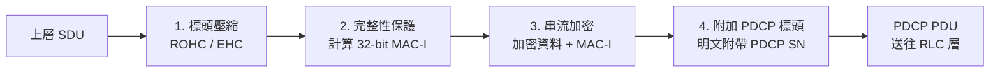

# 5G 空中介面安全架構 (Air Interface Uu Security & PDCP Protection)

> **一句話直觀定義**：5G 空中介面（Uu）安全是建立在 PDCP 協定層的防禦體系，透過 128-bit 串流加密（NEA）與 32-bit 完整性訊息認證碼（NIA），將開放無線電波空間中的通訊資料封裝為防竊聽、防竄改與防重送的密文通道 [3GPP TS 33.501 Rel-18 §6.5, §6.6; TS 38.323 §5.7, §5.8; 講義: 5G空中介面安全-Week5.pdf, p.6–11]。

---

## 💡 直觀原理解析 (Beginner-Friendly Explanation)

### 生活化比喻：在開放廣場上的「密碼防彈保險箱」
在有線網路中，電信機房鎖著防盜門，實體光纖埋在地下，外界難以接觸；但在 5G 空中介面（Uu），基地台與手機的對話是透過**向四面八方廣播的電磁波**進行的。任何人只要拿著無線接收機，都能截獲訊號。  
5G 空中介面安全就像是在開放廣場上運送貨物：
1. **防彈保險箱（128-NEA 加密）**：把每封信件放進保險箱，只有持有專屬密鑰的收件人能解鎖，偷聽者即使側錄也只能看到亂碼。
2. **防偽封條（128-NIA 完整性）**：在箱外貼上防偽封籤（32-bit MAC-I），任何人哪怕在飛行中試圖微調密文中的一個位元，收件端比對封籤不符就會立即將整箱丟棄。
3. **單向流水號（$COUNT = HFN \parallel SN$）**：每只箱子印上絕不重複的計數流水號，攻擊者就算錄下昨天的合法箱子今天重新發射，也會被立刻辨識為過期假貨。

### 為什麼安全機制做在 PDCP 層？
5G NR 的無線協定堆疊由上而下為：`SDAP → PDCP → RLC → MAC → PHY`。3GPP 嚴格將加密與完整性保護設計在 **PDCP（封包資料匯聚協定，TS 38.323）**，而非更底層的 MAC 或 PHY，基於四個關鍵工程考量 [講義 p.7]（W2 講義的 RAN 協定堆疊介紹也把 PDCP 定位為「header compression and security」層，負責加解密用戶資料 [講義: 5G 資通安全技術概論-W2.pdf, p.17–18]）：
1. **處理完整的資料單元（PDU）**：PDCP 位於 RLC 分段之前。在此加密可直接處理完整的資料封包，無需理會底層複雜的切割、重組與零碎重傳。
2. **現成的防重送計數器**：PDCP 天生為了解決順序傳送而維護 $COUNT$ 計數器，密碼學剛好需要一個「同一金鑰下永不重複的新鮮度因子」，兩者無縫融合。
3. **換手平滑不中斷**：基地台間換手（Handover）時，PDCP 層具備重建機制（PDCP re-establishment），金鑰切換的接縫剛好落在這一層。
4. **低層開銷放不下**：MAC 與 PHY 層的訊息（如 DCI、HARQ）生命週期極短（毫秒級）、格式緊湊至位元級，根本放不下 32-bit 的完整性標籤。

---

## ⚙️ 技術架構與運作機制 (Technical Mechanism)

### 1. PDCP 訊框處理順序 (Processing Order)
以**下行傳輸（Downlink）**為例，PDCP 收到上層資料後的嚴格執行步驟 [TS 38.323; 講義 p.9]：

> ⚠️ **兩大核心設計細節** [講義 p.9]：
> - **先整後密（MAC then Encrypt）**：下行先算 MAC-I 再加密；上行接收端則「先解密、再驗證 MAC-I」。此順序使 [[Security-Mode-Command]]（SMC）等關鍵程序得以在**不加密的情境下單獨啟用完整性防護**。
> - **PDCP 標頭（含 SN）強制明文傳送**：接收端必須先讀取明文的序號（PDCP SN），才能還原出完整的 $COUNT$，進而產生正確的解密金鑰流。

### 2. 加密機制：128-NEA (5G Encryption Algorithm)
依據 **TS 33.501 Annex D**，加密引擎輸入五大參數產生金鑰流（KEYSTREAM BLOCK），並與明文逐位元互斥或（XOR）：
$$C = M \oplus KS$$

| 輸入參數 | 位元長度 | 技術作用與防禦理由 [講義 p.10] |
|---|:---:|---|
| **KEY** | 128 bits | 採用 $K_{RRCenc}$（RRC 訊令）或 $K_{UPenc}$（使用者平面資料）。 |
| **COUNT** | 32 bits | 由 $HFN \parallel PDCP\ SN$ 組成，提供封包間單向遞增的唯一變化量。 |
| **BEARER** | 5 bits | 承載識別碼。確保同一裝置的不同 SRB/DRB 即使 COUNT 相同，金鑰流亦不碰撞。 |
| **DIRECTION** | 1 bit | 傳輸方向（`0` = 上行 Uplink，`1` = 下行 Downlink）。確保上行與下行金鑰流完全分離。 |
| **LENGTH** | 動態 | 所需的金鑰流長度。 |

> 💥 **金鑰流重用（Keystream Reuse）的致命危害**：  
> 串流密碼最致命的死穴在於「同一把金鑰使用了相同的 COUNT、BEARER 與 DIRECTION」：  
> 若 $C_1 = M_1 \oplus KS$ 且 $C_2 = M_2 \oplus KS$，則：
> $$C_1 \oplus C_2 = (M_1 \oplus KS) \oplus (M_2 \oplus KS) = M_1 \oplus M_2$$
> **金鑰流被完全抵銷！** 攻擊者無需金鑰即可取得兩段明文的互斥或，若已知其中一段明文（如固定協定標頭），另一段隱私資料將全數裸奔（如早期 WEP 漏洞）[講義 p.10]。

### 3. 完整性機制：128-NIA (5G Integrity Algorithm)
依據 **TS 33.501 Annex D**，完整性函式輸入 `KEY` ($K_{RRCint}/K_{UPint}$)、`COUNT`、`BEARER`、`DIRECTION` 與待保護的 `MESSAGE` 本體，計算出 **32-bit 的 MAC-I**。接收端以相同參數算出 $XMAC\text{-}I$，逐位元比對：
- **吻合**：確認未遭竄改且來源合法。
- **不符**：**靜默丟棄（Silent Discard）**該封包，絕不給予攻擊者明確的報錯反饋，防止攻擊者建立試驗預言機（Oracle）[講義 p.11]。

> 💡 **32-bit MAC-I 在工程上為什麼夠用？** [講義 p.11]  
> 純密碼學角度下，隨機猜中一個有效 32-bit MAC-I 的機率為 $2^{-32}$（約 43 億分之一）；若攻擊者能無限次嘗試，期望約 $2^{31}$ 次即可猜中——以純密碼學標準而言偏低。它在 5G 實務上夠用，是因為結合了**系統層防護** [講義 p.11]：
> 1. **通道速率上限**：無線空中通道的傳輸速率具備物理限制，嘗試次數因而受限。
> 2. **失敗不累積狀態**：每次失敗封包直接丟棄，攻擊者無法藉此獲取漸進資訊。
> 3. **告警機制**：大量的完整性驗證失敗會觸發網路端告警。
>
> 💡 講義的核心提醒：安全性由「密碼學強度」與「系統層防護」共同構成，只看位元數會誤判——32-bit MAC-I 看似太短卻夠用；廣播簽章密碼學上可行，卻因治理成本至今未強制（見 [[False-Base-Station-Defenses]]）。

### 4. COUNT 架構與 HFN 同步機制
$$COUNT = HFN \parallel PDCP\ SN \quad (32\text{ bits})$$
- **PDCP SN（低位）**：長度為 12 或 18 bits，隨封包在空中明文傳輸。
- **HFN（高位，Hyper Frame Number）**：不在空中傳送，雙方各自在本地維護。每當 PDCP SN 繞回（Wrap around）一圈，本地 HFN 便自動加 1。
- **COUNT 用盡處理**：在極高傳輸速率下，32-bit COUNT 有用盡繞回之風險。規格強制規定：**在 COUNT 即將完全繞回前，網路必須發起 intra-cell 換手重新推導 $K_{gNB}$**，絕對嚴禁同一把金鑰重用同一個 COUNT 值。規格稱此為 Key-change-on-the-fly 中的「local $K_{gNB}$ refresh（performed when PDCP COUNTs are about to wrap around）」，以 intra-cell handover 程序實現 [TS 33.501 Rel-18 §6.9.4.1; 講義 p.12, 24]。

---

## 🔐 5G 密碼演算法家族 (Cryptographic Agility)

3GPP 在 TS 33.501 Annex D 定義了三套具備不同數學結構的標準演算法，實現「密碼敏捷性（Cryptographic Agility）」——若其中一套數學機制被攻破，網路可秒級切換至另一套 [講義: 5G安全_TS33501-Week4.pdf, p.24]：

| 演算法系列 | 加密演算法 (NEA) | 完整性演算法 (NIA) | 核心密碼演算法 | 數學架構與特性 |
|---|---|---|---|---|
| **空演算法 (Null)** | `NEA0` | `NIA0` | 無加密 / 無保護 | 不提供任何安全性（NEA0 產生全零金鑰流）。**NIA0 只允許用於未認證的緊急通話**；在法規未要求支援未認證緊急通話的部署中，gNB 與 AMF 必須停用 NIA0（AMF 若允許此類通話，NAS 一律選 NIA0/NEA0）[TS 33.501 Rel-18 §5.2.3, §5.3.3, §5.5.2, §6.7.3.6, §10.2.2, Annex D; 講義: 5G安全_TS33501-Week4.pdf, p.24; 講義 p.12]。 |
| **1 系列** | `128-NEA1` | `128-NIA1` | **SNOW 3G** | 基於線性回饋移位暫存器（LFSR）的串流密碼，繼承自 3G/4G。 |
| **2 系列** | `128-NEA2` | `128-NIA2` | **AES** | 採用 **AES-CTR** 加密模式與 **AES-CMAC** 完整性模式。國際通用度最高。 |
| **3 系列** | `128-NEA3` | `128-NIA3` | **ZUC (祖沖之)** | 基於非線性回饋串流密碼架構，中國標準化組織主導並納入 3GPP。 |

---

## 🛡️ 安全防禦目標 (Security Objectives)

1. **空中鏈路機密性（Confidentiality）**：抵禦開放電磁波環境中的竊聽與側錄，保護信令與數據。
2. **傳輸完整性（Integrity Protection）**：確保 RRC 訊令與啟用 UP-IP 的資料在傳輸途中未遭惡意翻轉或置換。
3. **抗重送攻擊（Anti-Replay Protection）**：透過雙向獨立維護、隨封包嚴格遞增的 32-bit COUNT 機制，徹底封死封包側錄重放攻擊。

---

## 🔗 關聯概念與流程
- 安全建立程序：[[Security-Mode-Command]]
- 使用者平面保護：[[User-Plane-Integrity]]
- 空中威脅與偽基站：[[False-Base-Station-Defenses]]
- 架構分工對比：[[NAS-vs-AS-Security]]
- 金鑰衍生根基：[[Key-Hierarchy]]

---

## 📚 參考文獻與條款溯源 (References & Traceability)
- 3GPP TS 33.501 Rel-18:
  - §6.5 (RRC security mechanisms)
  - §6.6 (UP security mechanisms)
  - §6.9 (Security handling in mobility / Handover)
  - §6.9.4.1 (Key-change-on-the-fly, PDCP COUNT 繞回前之 local KgNB refresh)
  - §6.7.3.6 (Algorithm negotiation for unauthenticated UEs in LSM)、§10.2.2 (Unauthenticated IMS Emergency Sessions)
  - Annex D (Algorithms for ciphering and integrity protection)
- 3GPP TS 38.323: §5.7 (Ciphering and deciphering), §5.8 (Integrity protection and verification)
- 課程講義來源: `raw/lectures/5G空中介面安全-Week5.pdf` (第 1 章 p.6–8、第 2 章 p.9–13)
