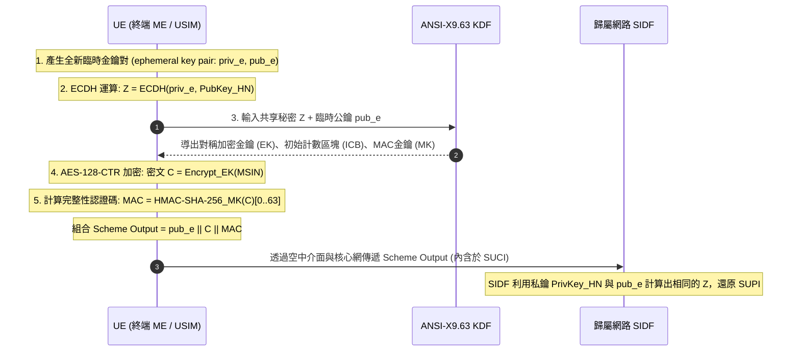

# 橢圓曲線整合加密方案 (ECIES - Elliptic Curve Integrated Encryption Scheme)

> **一句話直觀定義**：5G 終端用來將真實身分 [[SUPI]] 封裝為隱蔽代碼 [[SUCI]] 所採用的非對稱混合加密標準。

---

## 💡 直觀原理解析 (Beginner-Friendly Explanation)

- **生活化比喻**：  
  想像你要寄一張寫有真實身分的機密卡片給遠在老家的戶政事務所（Home Network）：
  1. 你先隨手在路邊做一把「一次性拋棄式鎖頭與鑰匙」（臨時金鑰對）。
  2. 你利用戶政事務所公開在外的投信孔形狀（公鑰），與自己的拋棄式鑰匙，在空中瞬間拼湊出一把「對稱保險箱密碼」。
  3. 用這把密碼將卡片快速上鎖，連同拋棄式鎖頭一起丟入郵筒。
  4. 路上任何郵差或間諜（假基地台）都打不開；而老家戶政事務所用自己的母鑰匙，一秒就能解開。
- **為什麼採用「混合加密（Hybrid Encryption）」？**：  
  非對稱加密（如 RSA 或純 ECC 運算）計算繁瑣且密文長度大；而對稱加密（AES）極快但需要預先共享金鑰。ECIES 結合兩者優點：**用非對稱（ECC）快速協商金鑰，用對稱（AES-CTR）高效加密身分**，兼顧了手機晶片的低功耗運算與極致安全性 [講義: 5G安全_TS33501-Week4.pdf, p.13]。

---

## ⚙️ 技術架構與運作機制 (Technical Mechanism)

依據 **3GPP TS 33.501 Rel-18 Annex C.3** 與密碼學標準 **SECG SEC 1**，5G 終端在產生 SUCI 時的 ECIES 運算包含以下五大步驟 [講義: 5G安全_TS33501-Week4.pdf, p.13-14]：

### 1. 五步加密演算法詳細剖析
1. **產生臨時金鑰對 (Ephemeral Key Pair)**：  
   UE 每次產生 SUCI，必須呼叫高品質亂數產生器生成一組全新的臨時公私鑰 $(\tilde{d}_{UE}, \tilde{Q}_{UE})$ [TS 33.501 Annex C.3.2]。這是達成「不可連結性（Unlinkability）」的關鍵——若重用金鑰，產生的 SUCI 將完全相同，追蹤漏洞依然存在。
2. **ECDH 協商共享祕密**：  
   UE 以臨時私鑰 $\tilde{d}_{UE}$ 與歸屬網路公鑰 $Q_{HN}$ 執行橢圓曲線 Diffie-Hellman 運算，導出共享秘密 $Z$：
   $$Z = \tilde{d}_{UE} \cdot Q_{HN}$$
3. **KDF 金鑰導出與展開**：  
   將 $Z$ 與臨時公鑰餵入 ANSI-X9.63 KDF，一次性展開為三組參數 [TS 33.501 Annex C.3.2]：
   - 對稱加密金鑰 $EK$ (16 bytes / 128 bits)
   - 初始計數區塊 $ICB$ (16 bytes)
   - 訊息認證碼金鑰 $MK$ (32 bytes)
4. **對稱加密 (AES-128-CTR)**：  
   以 $EK$ 與 $ICB$ 透過 AES 計數器模式（CTR）加密 MSIN。**為何選用 CTR 模式？**因為 CTR 模式的密文與明文完全等長，無需 Padding 填充，不會因為密文長度變化洩漏使用者號碼位數 [講義: 5G安全_TS33501-Week4.pdf, p.13]。
5. **完整性 MAC 計算**：  
   使用 HMAC-SHA-256 對密文計算完整性標籤，並截斷取前 8 bytes (64 bits)，確保密文在空中傳輸時未遭竄改 [TS 33.501 Annex C.1, C.3.2]。

---

### 2. 3GPP 兩大標準 Profile 技術參數對照
3GPP TS 33.501 Annex C 明定兩套 Profile供營運商配置使用：

| 項目 | Profile A (0x1) | Profile B (0x2) | 規格條款 |
|---|---|---|---|
| **橢圓曲線家族** | **Curve25519** (Bernstein 曲線) | **secp256r1** (NIST P-256) | TS 33.501 Annex C.3.4.1, C.3.4.2 |
| **金鑰協商機制** | X25519 | 標準 ECDH | TS 33.501 Annex C.3.4.1, C.3.4.2 |
| **臨時公鑰長度** | **32 bytes (256-bit)** | **33 bytes (264-bit)** (採用壓縮點表示) | TS 33.501 Annex C.1 |
| **對稱加密演算法** | AES-128-CTR | AES-128-CTR | TS 33.501 Annex C.3.4.1, C.3.4.2 |
| **完整性演算法** | HMAC-SHA-256 (截斷 64-bit) | HMAC-SHA-256 (截斷 64-bit) | TS 33.501 Annex C.3.4.1, C.3.4.2 |
| **設計特色** | 運算極快、抗側信道攻擊強、無 NIST 預設參數質疑 | 國際標準組織廣泛相容、傳統硬體加速普遍支援 | [講義: 5G安全_TS33501-Week4.pdf, p.14] |

> [!WARNING]
> **講義 Week3/4 的 Profile 參數有誤**：`5G資通-Week3, Week4.pdf` p.66 寫「Profile A (P-256 + AES-128 + HMAC-SHA256) 或 Profile B (Curve25519)」，把兩個 Profile 的曲線**對調**了；p.73 的表格曲線雖正確，卻把 Profile A 的對稱加密寫成 **AES-128-CBC**。規格明訂 Profile A 為 Curve25519、Profile B 為 secp256r1（P-256），兩者的對稱加密都是 **AES-128 in CTR mode** [TS 33.501 Rel-18 Annex C.3.4.1, C.3.4.2]；Week4 講義 p.14 的表格也與規格一致。簡報請以本頁上方表格為準。（2026-11-11 Claude Code，Week3/4 ingest 補記）

---

## ⚠️ 實作陷阱與未來演進

### 1. 亂數產生器（RNG）漏洞
密碼協定的安全性永遠取決於最脆弱的環節。若終端裝置（UE）的偽亂數產生器（PRNG）存在熵源不足或種子可被預測的問題，攻擊者即可預測臨時金鑰，使 ECIES 產生的 SUCI 具有可關聯性，甚至直接破解出共享祕密 $Z$ [講義: 5G安全_TS33501-Week4.pdf, p.14]。

### 2. 後量子密碼遷移 (Post-Quantum Transition)
ECIES 所基於的離散對數問題在足夠規模的量子電腦（Shor 演算法）面前將被完全破解。  
- **3GPP 的超前佈局**：依據 **TS 33.501 Rel-18 Annex C.1**，營運商專有保護方案的最大長度被特別放寬至 **3000 octets**，其目的就是為了未來無痛納入以晶格為基礎的抗量子演算法（如 ML-KEM / Kyber）[TS 33.501 Rel-18 Annex C.1 NOTE 1; 講義: 5G安全_TS33501-Week4.pdf, p.29]。

---

## 🔗 關聯概念與實體
- **涉及網元**：[[UE]]（加密端）、[[SIDF]]（解密端）
- **輸入與產物**：輸入為 [[SUPI]]，輸出為 [[SUCI]] 中的 Scheme Output
- **規範對比**：[[SUCI]]（結構說明）

---

## 📚 參考文獻與條款溯源 (References & Traceability)
- 3GPP TS 33.501 Rel-18:
  - Annex C.1 (Protection scheme identifiers and output sizes)
  - Annex C.3 (Elliptic Curve Integrated Encryption Scheme specification)
  - Annex C.3.4.1 (Profile A - Curve25519)
  - Annex C.3.4.2 (Profile B - secp256r1)
  - Annex C.4 (Implementers' test data)
- SECG SEC 1: Elliptic Curve Cryptography (Version 2.0)
- 課程講義來源: `raw/lectures/5G安全_TS33501-Week4.pdf` (第 3 章 p.13-14、第 8 章 p.29)
