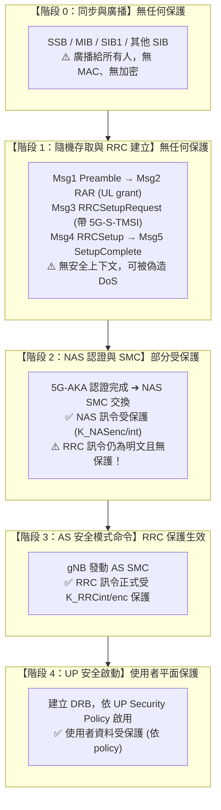
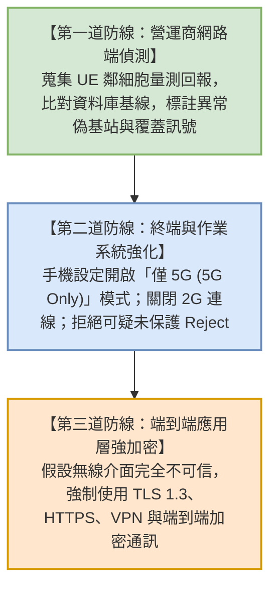

# 偽基地台與未受保護訊息防禦 (False Base Station Defenses & Unprotected Messages)

> **一句話直觀定義**：5G 透過 SUCI 與 Home Control 斬斷了偽基地台（IMSI Catcher）竊取身分與冒充核心網的捷徑，但在建立安全上下文之前的初始階段（廣播、隨機存取、連線建立），協定仍存在「物理上無法加密」的結構性空窗，成為訊號覆蓋與側通道攻擊的殘留戰場 [3GPP TR 33.809; 講義: 5G空中介面安全-Week5.pdf, p.5, 14–23]。

---

## 💡 直觀原理解析 (Beginner-Friendly Explanation)

### 生活化比喻：大樓接待大廳的「身分驗證前空窗」
- **5G 做到的進步（有密碼之後）**：進入管制區後，每個人戴著專屬的動態密碼手環（[[Air-Interface-Security]]），任何假警衛都騙不走你的資料。即使路人拿假證件冒充警衛，母公司總部（Home Control [[AUSF]]）也會在最後關頭擋下他。
- **5G 尚未解決的盲點（驗證密碼之前）**：任何人走進大樓接待大廳時，此時訪客與警衛之間**互不相識、沒有任何共享密鑰**：
  - 門口牆上的公告欄（系統廣播 SIB/MIB）人人都能貼假通知（例如「本出口施工封閉，請改走 2G 逃生梯」）。
  - 大廳廣播系統（Paging）對著全場喊名字時，埋伏在旁的間諜雖然聽不懂密碼，但只要看到哪個人轉頭，就能推斷目標人物是否就在現場（側通道攻擊）。

> 💡 **核心思維**：**「不能保護」與「選擇不保護」是兩回事** [講義 p.5]。  
> 廣播與初始存取無法防護，是蜂巢式網路的「結構性限制」（接收端尚未獲取任何金鑰）；明白這個界線，才能看懂 5G 真正的安全防禦邊界。

> 🎯 **問題的本質**：5G 保護了「用戶身分」，也認證了「核心網」，但它**並沒有在建立安全上下文之前認證「這個細胞」**。只要這個空窗存在，覆蓋攻擊就有落腳點；[[SUCI]] 與 Home Control 都無法涵蓋這個層面 [講義: 5G空中介面安全-Week5.pdf, p.19]。
> 在 5G 中，傳統假基地台雖拿不到永久身分（SUCI）、也無法偽造認證成功（Home Control），但**仍可以**送出 Identity Request、送出 RRCReject、蒐集裝置能力資訊，或觸發降級 [講義: 5G空中介面安全-Week5.pdf, p.18]。

---

## ⚙️ 認證前結構性空窗與未保護訊息總覽

### 安全生效時間軸（階段 0 至 階段 4）

### 哪些訊息永遠不受完整性保護？[講義 p.16–17]

| 協定層級 | 訊息 / 程序 | 為什麼在協定上不能保護？ | 攻擊者可利用的攻擊手法 |
|---|---|---|---|
| **PHY** | **SSB (PSS/SSS/PBCH)** | 同步訊號本身就是「讓尚未入網的陌生終端尋找基地台」的實體設計。 | 偽造假細胞（Fake Cell）、吸引手機接入。 |
| **PHY** | **MIB (Master Info Block)** | 承載於 PBCH，欄位極端精簡，完全塞不下數位簽章或 MAC。 | 偽造細胞基本組態參數。 |
| **RRC** | **SIB1 與其他 SIB** | 必須廣播給所有人，包含尚未註冊、無共享金鑰的 UE。 | 篡改細胞重選門檻、篡改鄰細胞清單、偽造緊急警報（ETWS/CMAS）。 |
| **RRC** | **Paging 尋呼訊息** | 必須在 UE 建立連線前由基地台向待機裝置喊話。 | 發動 Paging 側通道攻擊（ToRPEDO），推斷用戶是否在場。 |
| **PHY/MAC** | **隨機存取 (Msg1, Msg2)** | 裝置尚未宣告身分，網路尚未分配金鑰。 | 耗盡前導碼（Preamble Exhaustion）、偽造上行授權（UL grant）。 |
| **RRC** | **RRCSetupRequest / Reject** | AS 安全模式尚未啟動。 | 偽造 `RRCReject` 發動阻斷服務（DoS）或誘導轉向。 |
| **MAC** | **MAC 控制元素 (MAC CE)** | 格式緊湊（僅 1–2 bytes），生命週期極短，放不下 MAC-I。 | 偽造次載波啟用命令（增加手機耗電）、關閉參考訊號。 |
| **PHY** | **下行控制資訊 (DCI)** | 每個時槽（Slot）均需解碼，加入密碼標籤將導致極高排程開銷。 | 偽造排程授權、誘發式干擾（Induced Interference）。 |
| **PHY** | **參考訊號、波束管理回報** | 本質上是量測用的實體訊號。 | 被動定位與追蹤。 |
| **UP** | **使用者資料（policy = not needed）** | 可以保護，但營運商選擇不啟用。 | 位元翻轉竄改。 |

> 📌 **分類結論**：上表前九列是**結構性**的——目前的協定設計無法保護；最後一列是**政策性**的——規格提供了機制，是否啟用取決於營運商 [講義: 5G空中介面安全-Week5.pdf, p.17]。

### 為什麼低層訊息塞不下保護？功能下移的趨勢
- **攻擊面隨功能下移而擴大**：5G 與後續版本不斷把功能從高層搬到低層以換取延遲，但保護機制仍留在 PDCP；每一次下移都可能製造出新的、未受保護的控制面 [講義: 5G空中介面安全-Week5.pdf, p.5]。
- **最新例子 LTM（L1/L2 觸發移動性）**：傳統換手由 RRC 訊令觸發；LTM 改由 MAC CE 觸發，可在毫秒級完成細胞切換，候選細胞設定事先透過受保護的 RRC 下發 [講義: 5G空中介面安全-Week5.pdf, p.26]。（講義稱其安全處理在 TS 33.501 §6.17，但本庫的 V18.12.0 無此條，見 [[SRC-Week5-Air-Interface]]。）
- **講義的課堂提問**：要為 MAC CE 加上完整性保護會遇到什麼困難？提示：MAC CE 通常只有一到兩個位元組；MAC 層沒有 COUNT 計數器；HARQ 重傳會讓同一則訊息出現多次 [講義: 5G空中介面安全-Week5.pdf, p.26]。

---

## 🎯 針對未保護訊息的四大多發攻擊手法

### 1. 訊號覆蓋攻擊（Signal Overshadowing）
- **攻擊原理**：攻擊者不架設完整的假細胞，而是「覆蓋」合法基地台的特定訊息。攻擊者精準鎖定特定時序與頻率，以略高的射頻功率發射偽造封包，使接收端在解調時選擇解出攻擊者的封包版本 [Yang et al., USENIX Security 2019；Erni et al. 的 AdaptOver 為自適應版本；講義 p.18–19]。
- **難以偵測**：合法細胞仍在正常運作，因此傳統「偵測異常細胞」的方法看不到它 [講義 p.19]。
- **5G SA 受害面**：講義列出在 5G 獨立組網中仍可能被覆蓋的訊息包括廣播系統資訊（MIB / SIB）、Paging 訊息、RRC 連線建立初期的訊息、NAS Identity Request，以及 RRC 與註冊的 Reject 訊息 [講義 p.19]；例如覆蓋下行廣播（MIB/SIB）、Paging 訊息或未保護的 `RRCReject`，誘導 UE 放棄連線或轉向惡意載波。

### 2. Paging 側通道隱私嗅探（ToRPEDO 攻擊）
- **攻擊原理**：UE 在待機狀態（RRC_IDLE）時，僅在固定的呼叫時機（Paging Occasion）醒來監看訊息。該時機由 UE 的識別碼經數學公式公開計算得出 [Hussain et al., NDSS 2019; 講義 p.19]。
- **攻擊鏈**：攻擊者在短時間內撥打目標手機並迅速掛斷（不驚動受害者），比對哪個 Paging Occasion 出現訊息 [講義 p.19]。即可定位目標的呼叫時機，進而確認目標是否在該追蹤區內。
- **教學重點**：攻擊者沒有破解任何密碼學，也沒有讀到任何加密內容——他利用的是協定「必須在明文中做的事」所洩漏的資訊。**密碼學保護的是內容，不是「有沒有發生」這件事本身** [講義: 5G空中介面安全-Week5.pdf, p.19]。
- **衍生風險**：若營運商未頻繁更換暫時識別碼（[[5G-S-TMSI]]），該識別碼便會淪為永久追蹤的標籤，使得 [[SUCI]] 辛苦建立的身分隱私防線形同虛設。

### 3. 跨世代與誘導式降級（Bidding-Down）
講義把降級攻擊分成四類 [講義: 5G空中介面安全-Week5.pdf, p.20]：

| 類型 | 攻擊方式 | 為什麼有用 | 現行防護 |
|---|---|---|---|
| **跨世代降級** | 偽基地台只廣播 4G 或 3G 細胞，或在 5G SIB 中把本細胞標為禁止接入（Cell Barred），逼 UE 回退到舊制式 | 4G 沒有 SUCI（IMSI 明文）、沒有 UP 完整性保護，攻擊面大得多 | UE 可設定「僅 5G」模式（多數手機有此選項但預設不開）；網路端可移除舊制式，但因涵蓋率考量難以落實 |
| **演算法降級** | 在 AS 安全建立前竄改 UE 宣告的安全能力，讓 gNB 誤以為 UE 只支援 NEA0 / NIA0 | 選到 null 演算法等於完全沒有保護 | ★ **已被防住**：AS SMC 原封重播 UE 的安全能力，且受 K_RRCint 保護（見 [[Security-Mode-Command]]） |
| **UP 保護降級** | 誘導網路或 UE 不啟用使用者平面完整性保護 | 開啟位元翻轉攻擊的大門 | policy 設為 required 時網路必須拒絕連線；但若設為 preferred 或 not needed，本來就沒有保護可降 |
| **拒絕服務式誘導** | 偽造 RRCReject、RegistrationReject 或帶特定原因值的 Release，讓 UE 認為此網路不可用而轉向 | 把 UE 推向攻擊者控制或監控的細胞 | 部分 reject 原因值在較新版本中已要求受保護或限制使用，但初始階段的 reject 本質上仍無法保護 |

> 📌 第二列是**唯一「已被完整防住」**的一類，其餘三類都還有結構性缺口 [講義: 5G空中介面安全-Week5.pdf, p.20]。

### 4. 缺少 UP 完整性保護之位元翻轉攻擊
- 若營運商因算力考量未啟用 [[User-Plane-Integrity]]（Policy 設為 `Not needed`），攻擊者可發動 **aLTEr / IMP4GT** 攻擊，利用串流加密的可延展性精準竄改 DNS 解析結果，劫持上網連線 [講義 p.20–21]。

### 5. 低層控制程序攻擊
這些程序在 4G 與 5G 中都**完全沒有加密也沒有完整性保護**，而且攻擊所需的設備成本低、不需要修改受害裝置 [講義: 5G空中介面安全-Week5.pdf, p.21]：

| 程序 | 可被怎麼利用 | 影響 |
|---|---|---|
| 隨機存取（RA） | 被動觀察 RA 程序可推算 UE 位置；偽造 SIB 可阻擋 UE 初始接入；偽造 PDCCH order 可強制 UE 斷線重連 | 定位、拒絕服務 |
| 下行控制資訊（DCI） | 偽造上行授權迫使 UE 傳送填充資料，形成「誘發式干擾」，短時間內大幅壓低合法傳輸吞吐量；偽造 HARQ 回饋可製造持續重傳 | 拒絕服務、耗電 |
| MAC 控制元素（CE） | 偽造次細胞（SCell）啟用命令，迫使 UE 長時間開啟多個載波的射頻鏈路，造成顯著耗電；偽造去啟用命令則關閉參考訊號 | 耗電、通道估計失效 |
| 參考訊號與波束回報 | SRS、CSI-RS 與 CSI 回報是實體量測訊號，被動側錄可用於到達時間差定位與移動軌跡推斷 | 被動追蹤 |

> 被動攻擊的可怕之處是**完全無法偵測**——攻擊者只需要一台接收機、不發射任何訊號；主動攻擊會留下無線足跡，因此網路端偵測是目前最實際的防線 [講義: 5G空中介面安全-Week5.pdf, p.18]。
---

## 🛡️ 現行防禦與 3GPP 研擬對策 (TR 33.809)

3GPP 自 Rel-16 起持續維護 **TR 33.809**（Study on 5G security enhancements against False Base Stations）。它是「技術報告（TR）」而非「技術規格（TS）」——**記錄候選方案與分析，但不構成強制要求**，其中討論的機制至今仍未成為 TS 33.501 的必備項目 [講義: 5G空中介面安全-Week5.pdf, p.27]。

| 候選方案 | 怎麼做 | 代價與限制 | 狀態 |
|---|---|---|---|
| 廣播訊息數位簽章 | 網路以私鑰簽署 MIB/SIB，UE 以事先取得的公鑰驗證，含時間戳記或計數器防重放 | 需要公鑰散布與撤銷、精確時間同步；佔用廣播容量；UE 需具驗證能力 | 研究中 |
| 網路端偵測 | 用 UE 回報的鄰細胞量測與網路自身細胞資料庫比對，找出不存在的細胞 | 只能事後偵測；需營運商建置分析平台；覆蓋攻擊不一定露出異常細胞 | 已有商用實作 |
| 選定訊息的雜湊保護 | 對部分關鍵訊息加雜湊或時間戳記，讓 UE 取得安全上下文後回溯驗證 | 只能事後發現竄改；需協定變更 | 研究中 |
| UE 端行為強化 | 限制 UE 接受未受保護 reject、限制降級、對可疑細胞加冷卻期 | 可能誤傷正常網路行為（如真實壅塞控制）；需終端韌體更新 | 部分已納入規格 |

### 為什麼「幫系統廣播加數位簽章」在工程上極其困難？[講義 p.27–28]
看似最直觀的密碼解法是「讓基地台用私鑰對 SIB 廣播進行非對稱簽章，手機用公鑰驗算」，但在全球電信工程上遭遇五大障礙：
1. **公鑰預置的「雞生蛋困境」**：UE 必須在「還沒連上任何網路」時就持有正確的公鑰。寫進 USIM？換金鑰時怎麼辦？由網路下發？那第一次怎麼辦？
2. **斷網環境下的憑證撤銷**：若某個基地台私鑰外洩，手機在未接入網路前無法透過 CRL 或 OCSP 查核撤銷清單，而這正是遭偽基站攻擊的情境。
3. **防重播的時間同步矛盾**：數位簽章只能證明訊息真偽，不能證明「新鮮度」。防止攻擊者重放舊 SIB 需要時間戳，但手機校準時間本身仰賴基地台廣播。
4. **廣播頻寬容量珍貴**：橢圓曲線簽章約 64 bytes，加上公鑰識別碼與時間戳記可能接近 100 bytes；廣播通道是全細胞用戶共享的稀缺資源，而且每個週期都要重播。
5. **低階物聯網裝置延遲**：UE 在初始細胞搜尋時要快速評估多個候選細胞，若每個都做一次公鑰驗證，開機時間與細胞重選延遲都會受影響，尤其在低階物聯網裝置上（講義未給出具體秒數）。

> **學術界的結論**：已有多篇論文評估廣播簽章方案，結論大致一致——**技術上可行，但部署與治理的成本遠高於密碼學本身**；講義也指出五個障礙中只有第四個（容量）與密碼學本身有關 [講義: 5G空中介面安全-Week5.pdf, p.27–28]。

### 💡 今日實際可用的三道防線 [講義 p.28]

### 🔭 研究方向與展望
- **以 AI/ML 做異常偵測**：用無線量測與訊令特徵訓練模型，即時辨識偽基地台、覆蓋攻擊與異常干擾；挑戰在於缺乏公開標註資料集，以及誤報成本 [講義: 5G空中介面安全-Week5.pdf, p.28]。
- **實體層安全（PLS）**：利用通道的互易性與隨機性直接產生金鑰，或以波束成形讓竊聽者訊噪比低於合法接收者；理論優雅，但對通道模型的假設在真實環境常不成立 [講義: 5G空中介面安全-Week5.pdf, p.28]。
- **低層控制的輕量保護**：研究能塞進 DCI / MAC CE 的極短認證碼，或以物理層特徵取代密碼學標籤；核心難題是開銷與重傳處理 [講義: 5G空中介面安全-Week5.pdf, p.29]。
- **廣播認證的可行路徑**：延伸 TR 33.809 的簽章方案，探討委派式簽章、群組簽章或新的公鑰散布治理模式 [講義: 5G空中介面安全-Week5.pdf, p.29]。
- **後量子的影響**：後量子簽章的長度遠大於 ECC，會讓「容量放不下」的問題更嚴重 [講義: 5G空中介面安全-Week5.pdf, p.29]。
- **6G 的設計機會**：6G 尚在標準化早期，是把「認證前保護」納入基礎設計的少數機會之一 [講義: 5G空中介面安全-Week5.pdf, p.29]。
- 想動手做實驗前，請先讀 [[Research-Ethics]]。

---

## 🔗 關聯概念與流程
- 空中機制：[[Air-Interface-Security]]
- 資料防竄改：[[User-Plane-Integrity]]
- 安全建立程序：[[Security-Mode-Command]]
- 身分防護基礎：[[SUPI]], [[SUCI]]
- 對比分析：[[4G-vs-5G-AKA]]
- 研究倫理：[[Research-Ethics]]

---

## 📚 參考文獻與條款溯源 (References & Traceability)
- 3GPP TR 33.809: Study on 5G security enhancements against False Base Stations (Rel-16/17/18)
- 3GPP TS 33.501 Rel-18:
  - §5.10 (Security visibility and configurability)
  - §6.7.2 (NAS SMC & Bidding-down defenses)
  - §6.7.4 (AS SMC procedure)
  - §6.12 (Subscription identifier privacy)
- 學術研究文獻:
  - H. Yang et al., "Hiding in Plain Signal: Physical Signal Overshadowing Attack on LTE," USENIX Security 2019
  - S. Hussain et al., "Privacy Attacks to the 4G and 5G Cellular Paging Protocols Using Side Channel Information," NDSS 2019 (ToRPEDO)
  - M. Ludant et al., "Unprotected 4G/5G Control Procedures at Low Layers Considered Dangerous," arXiv:2403.06717 (2024)
- 課程講義來源: `raw/lectures/5G空中介面安全-Week5.pdf` (p.5、第 3 章 p.14–17、第 4 章 p.18–23、第 5 章 p.26、第 6 章 p.27–29)
