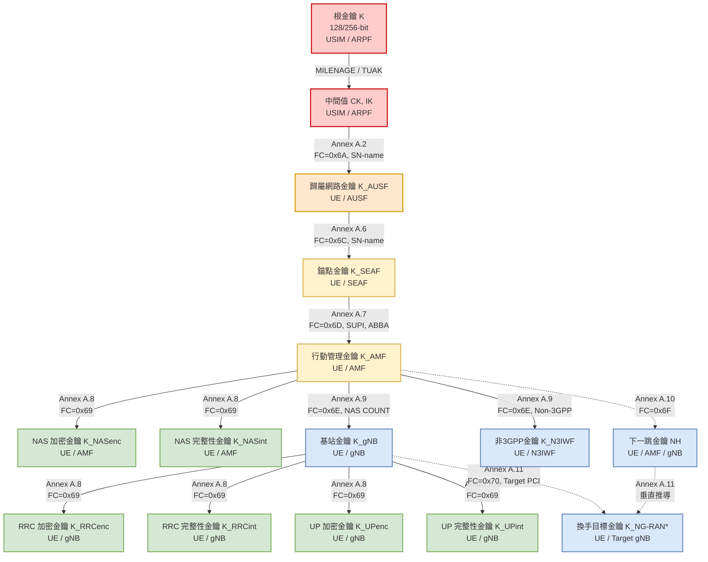

# 5G 金鑰階層與推導體系 (5G Key Hierarchy & Derivation)

> **一句話直觀定義**：5G 金鑰階層是一棵以 SIM 卡硬體根金鑰 $K$ 為源頭、隨通訊層級與信任邊界逐步向下「枝繁葉茂」的單向密鑰衍生樹，確保每一層網路節點只拿到最低權限的工作金鑰 [3GPP TS 33.501 Rel-18 §6.2; 講義: 5G安全_TS33501-Week4.pdf, p.20]。

---

## 💡 直觀原理解析 (Beginner-Friendly Explanation)

### 生活化比喻：跨國企業的權限授權金字塔
想像一間跨國保全企業：
1. **最高機密保險庫（根金鑰 $K$）**：母公司董事長保險庫裡藏著唯一的一枚傳家印鑑，**這個印章一輩子不出保險庫**（只存在於 [[USIM]] 晶片與核心網 [[ARPF]]）。
2. **總部派任證書（$K_{AUSF}$）**：母公司認證機構 [[AUSF]] 依印鑑核發歸屬網路級的授權證書。
3. **地方分公司通行牌（$K_{SEAF}$）**：到了海外拜訪網路，AUSF 發給當地分公司經理（[[SEAF]]）一面駐地盾牌。這面盾牌無法反推母公司的傳家印章。
4. **部門鑰匙（$K_{AMF}$）與公務員卡（$K_{gNB}$）**：分公司經理授權給辦公室主任（[[AMF]]），主任再發給大樓外門警衛（[[gNB]] 基地台）執勤鑰匙。
5. **拋棄式對講機暗號（NAS / AS 演算法金鑰）**：警衛每次和訪客對話或換班，都換一個臨時暗號。

### 為什麼不一把萬能金鑰用到底？
最直覺的工程做法是「認證完產生一把工作金鑰，全部加密通訊都用它」。5G 堅決屏棄這種做法，原因在於三大核心安全痛點 [講義: 5G安全_TS33501-Week4.pdf, p.20]：
1. **金鑰分離（Key Separation）**：不同用途、不同實體必須持有不同金鑰。基地台常架設於無人看守的屋頂或第三方電塔，極易遭受物理入侵。若一把鑰匙通到底，**一台基地台被攻破將導致全核心網通訊全部遭竊聽**。
2. **生命週期不同（Lifetime Discrepancy）**：基地台金鑰必須在每次手機換手（Handover）時即時更換；核心網金鑰在用戶數天註冊期間相對穩定。硬綁在一起將逼迫全網以最高頻率頻繁同步，引發信令風暴。
3. **信任邊界不同（Trust Boundaries）**：歸屬網路（Home）、拜訪網路（Serving）與無線基地台（RAN）的受信任等級完全不同。金鑰樹確保「下層永遠算不出上層、邊緣永遠推不回核心」。

---

## ⚙️ 技術架構與金鑰階層圖 (Technical Architecture & Hierarchy)

### 5G 全域金鑰推導樹 (Key Tree)

---

## 📊 5G 金鑰全覽速查表

| 層級 | 金鑰名稱 | 由誰推導 | 持有實體 | 技術用途 | 失效與更新時機 [講義 p.22] |
|---|---|---|---|---|---|
| **信任根** | **$K$** | 預先燒錄 | [[USIM]]、[[ARPF]] | 認證與所有金鑰的根本起點 | 永不更新（除非換發實體 SIM 卡） |
| **中間值** | **$CK, IK$** | 由 $K$ 運算產生 | [[USIM]]、[[ARPF]] | 推導 $K_{AUSF}$ 與認證回應的中間值 | 每次執行主要認證時重新產出 |
| **歸屬網路層** | **$K_{AUSF}$** | 由 $CK \parallel IK$ 推導 | [[UE]]、[[AUSF]] | 歸屬網根基；可用於漫遊導引（SoR）保護 | 下次主要認證時更新 |
| **錨點層** | **$K_{SEAF}$** | 由 $K_{AUSF}$ 推導 | [[UE]]、[[SEAF]] | 拜訪網路錨點金鑰，代表一次註冊的信任 | 推導出 $K_{AMF}$ 後即應安全刪除 |
| **行動管理層** | **$K_{AMF}$** | 由 $K_{SEAF}$ 推導 | [[UE]]、[[AMF]] | 推導所有 NAS 訊令與基站金鑰之母金鑰 | AMF 變更、主要認證、或金鑰刷新時更新 |
| **NAS 保護層** | **$K_{NASenc}$ $K_{NASint}$** | 由 $K_{AMF}$ 推導 | [[UE]]、[[AMF]] | 加密與保護 UE 與 AMF 間之 NAS 控制訊息 | NAS SMC 重新執行或變更密碼演算法時更新 |
| **無線存取層** | **$K_{gNB}$** | 由 $K_{AMF}$ 推導 | [[UE]]、[[gNB]] | 無線接取網路根金鑰 | 每次換手、每次從待機（IDLE）回連線時更新 |
| **AS 訊令保護** | **$K_{RRCenc}$ $K_{RRCint}$** | 由 $K_{gNB}$ 推導 | [[UE]]、[[gNB]] | 保護空中介面 RRC 控制訊令 | 隨 $K_{gNB}$ 更新同步重新計算 |
| **使用者平面保護** | **$K_{UPenc}$ $K_{UPint}$** | 由 $K_{gNB}$ 推導 | [[UE]]、[[gNB]] | 保護空中介面上傳與下載之真實用戶流量 | 隨 $K_{gNB}$ 更新同步重新計算 |
| **換手前向保護** | **$NH$ / $NCC$** | 由 $K_{AMF}$ / $NH$ 迭代 | [[UE]]、[[AMF]]、[[gNB]] | 換手金鑰鏈，實現換手時的「前向安全」 | 每次執行換手時前推一格 |

---

## 📐 密碼推導函式規範 (Generic KDF & Annex A 參數速查)

3GPP 在 TS 33.220 Annex B 與 TS 33.501 Annex A 定義了標準化的通用 KDF：
$$\text{Derived Key} = \text{HMAC-SHA-256}(\text{Key}, S)$$

輸入字串 $S$ 採無歧義格式封裝：
$$S = FC \parallel P_0 \parallel L_0 \parallel P_1 \parallel L_1 \parallel \dots \parallel P_n \parallel L_n$$
- **$FC$ (Function Code)**：1 個位元組（Byte）的常數識別碼，指名此運算屬於哪一種金鑰推導用途。
- **$P_i$ (Parameter)**：輸入情境參數值。
- **$L_i$ (Length)**：對應參數 $P_i$ 的長度（2 個位元組，Big-Endian 編碼）。

### 為什麼需要 FC 與長度欄位 $L_i$？
1. **防止領域分離攻擊（Domain Separation Attack）**：同一個母金鑰常被用來導出多種不同子金鑰。若無 $FC$ 標籤，攻擊者可刻意構造相同格式的輸入，使得「用途 A 的金鑰」與「用途 B 的金鑰」算出一模一樣的值。$FC$ 強制隔離不同推導的密碼命名空間 [講義 p.21]。
2. **消除字串串接歧義**：若無長度欄位 $L_i$，$P_0=\text{"AB"}, P_1=\text{"C"}$ 與 $P_0=\text{"A"}, P_1=\text{"BC"}$ 串接後均為 `"ABC"`。明確編入長度，保證位元串接在數學上的一對一映射（Injective Mapping）。

### Annex A 主要推導參數速查表

| 推導目標 | FC 值 | 輸入金鑰 (Key) | 輸入參數 ($P_0, P_1, \dots$) | 3GPP 條款出處 |
|---|:---:|---|---|---|
| **$K_{AUSF}$** | `0x6A` | $CK \parallel IK$ | $P_0 = SN\text{-}name$, $P_1 = SQN \oplus AK$ | TS 33.501 Annex A.2 |
| **$RES^* / XRES^*$** | `0x6B` | $CK \parallel IK$ | $P_0 = SN\text{-}name$, $P_1 = RAND$, $P_2 = RES / XRES$ | TS 33.501 Annex A.4 |
| **$K_{SEAF}$** | `0x6C` | $K_{AUSF}$ | $P_0 = SN\text{-}name$ | TS 33.501 Annex A.6 |
| **$K_{AMF}$** | `0x6D` | $K_{SEAF}$ | $P_0 = SUPI$, $P_1 = ABBA$ | TS 33.501 Annex A.7 |
| **演算法金鑰** ($K_{NAS...}, K_{RRC...}, K_{UP...}$) | `0x69` | $K_{AMF}$ 或 $K_{gNB}$ | $P_0 = \text{演算法類型代碼 (0x01..0x06)}$, $P_1 = \text{演算法辨識碼 (0x01..0x03)}$ | TS 33.501 Annex A.8 |
| **$K_{gNB}$ / $K_{N3IWF}$** | `0x6E` | $K_{AMF}$ | $P_0 = \text{Uplink NAS COUNT}$, $P_1 = \text{存取類型 (3GPP=0x01, Non-3GPP=0x02)}$ | TS 33.501 Annex A.9 |
| **下一跳金鑰 $NH$** | `0x6F` | $K_{AMF}$ | $P_0 = \text{前一個 } NH \text{ 或初始 } K_{gNB}$ | TS 33.501 Annex A.10 |
| **換手金鑰 $K_{NG-RAN}^*$** | `0x70` | $K_{gNB}$ 或 $NH$ | $P_0 = \text{目標細胞 PCI}$, $P_1 = \text{目標 ARFCN-DL}$ | TS 33.501 Annex A.11 |

> 💡 **核心設計規律：情境鎖死（Context Binding）**  
> 留意金鑰樹每往下走一層，就會綁入全新的情境參數：  
> - $SN\text{-}name$ 鎖死拜訪網路  
> - $SUPI$ 與 $ABBA$ 鎖死用戶真實身分與抗降級架構  
> - $\text{Uplink NAS COUNT}$ 鎖死時間點與信令序列  
> - 演算法代碼鎖死專屬用途  
> - 細胞識別碼（PCI, ARFCN）鎖死特定物理天線細胞  
> 任何人即使側錄或偷得某一節點的金鑰，**絕對無法挪到任何其他情境或節點重複使用**。

---

## 🚚 換手時的金鑰接力：水平推導 vs 垂直推導 (Handover Key Handling)

> **生活化比喻**：搬家換鎖。「水平推導」像是舊房東（源基地台）幫你配新家的鑰匙——快，但舊房東手上也知道新鑰匙的樣子；「垂直推導」則是由管委會（AMF）直接把一把舊房東從沒見過的新鑰匙交給新房東——慢一點，但舊房東再也打不開你的新家。

### 1. $K_{gNB}$ 什麼時候必須更新 [講義: 5G空中介面安全-Week5.pdf, p.24]
| 時機 | 怎麼換 | 為什麼必須換 |
|---|---|---|
| 進入 RRC_CONNECTED | 由 $K_{AMF}$ 與當時的上行 NAS COUNT 導出新 $K_{gNB}$ | 同一把 $K_{AMF}$ 每次導出不同 $K_{gNB}$，避免跨連線重用 |
| 換手 (Handover) | 水平或垂直推導出 $K_{NG\text{-}RAN}^*$，作為目標細胞的 $K_{gNB}$ | 垂直推導時源、目標基地台不共用金鑰 |
| 從 RRC_INACTIVE 恢復 | 依 NCC 決定水平或垂直推導 | INACTIVE 期間 UE 可能已移到別的細胞 |
| PDCP COUNT 即將繞回 | 以 intra-cell handover 強制更新 | 否則同一金鑰重用同一 COUNT → 金鑰流重用（見 [[Air-Interface-Security]]） |

### 2. 兩種推導方式 [TS 33.501 Rel-18 §6.9.2.3; Annex A.10, A.11; 講義 p.25]
- **水平推導**：$K_{NG\text{-}RAN}^* = \text{KDF}(\text{現用 }K_{gNB},\ \text{目標 PCI},\ \text{目標 ARFCN-DL})$。所有輸入源基地台都有，因此**源基地台算得出目標的金鑰**。
- **垂直推導**：$K_{NG\text{-}RAN}^* = \text{KDF}(\text{未使用過的 }NH,\ \text{目標 PCI},\ \text{目標 ARFCN-DL})$。$NH$ 由 [[AMF]] 以單向鏈（$NH_1 \leftarrow K_{AMF}$，$NH_{i+1} \leftarrow NH_i$）產生，每個 $NH$ 配一個只增不減的 $NCC$（Next hop Chaining Counter）。UE 收到比自己大的 NCC 就知道要往前推幾格，兩端不必額外協商即可同步。

### 3. Xn 換手 vs N2 換手 [TS 33.501 Rel-18 §6.9.2.3.2, §6.9.2.3.3; 講義 p.24]
| 面向 | Xn 換手（基地台直連） | N2 換手（經 AMF 協調） |
|---|---|---|
| 推導方式 | 源 gNB 有未使用 {NH, NCC} 時用垂直推導，否則水平推導 | 垂直推導（AMF 提供新的 {NH, NCC} 給目標 gNB） |
| 前向安全 | 有限：源基地台知道目標金鑰 | 較強：源基地台算不出目標金鑰 |
| 延遲 | 低（不繞核心網） | 較高 |

> [!NOTE]
> **規格比講義更精確的一點**：Xn 換手完成後，目標 gNB 才送 PATH SWITCH REQUEST 給 AMF，AMF 這時才回一組新的 {NH, NCC}——它只能用在「下一次」換手。因此規格明寫 Xn 換手的金鑰分離要「兩跳之後」才發生（"key separation happens only after two hops"），目標 gNB 也可以立即發起一次 intra-cell 換手提早用上新 NH [TS 33.501 Rel-18 §6.9.2.3.2 NOTE 1]。講義則從營運角度描述為「網路通常會週期性插入一次 N2 換手，把前向安全拉回來」[講義 p.24]。

### 4. 連線重建時的身分證明：shortMAC-I [TS 33.501 Rel-18 §6.11; 講義 p.25–26]
無線鏈路失敗、換手失敗或完整性驗證失敗時，UE 送出 `RRCReestablishmentRequest` 並附上以**舊的** $K_{RRCint}$ 計算的 shortMAC-I，證明自己是原本那台 UE；目標細胞驗證通過才允許重建，且重建後**必須推導新的 $K_{gNB}$**。從 RRC_INACTIVE 恢復時則使用 resumeMAC-I [講義 p.25]。

---

## 🛡️ 安全防禦目標 (Security Objectives)

1. **前向安全與後向安全（Forward & Backward Secrecy）**：  
   在基站換手場景中，利用垂直推導（Vertical Key Derivation）與單向雜湊鏈（$NH / NCC$），新基站無法回推用戶過去在舊基站的通訊內容，舊基站也無法推算出用戶未來在新基站的金鑰。
2. **信任邊界物理隔離**：  
   將基地台金鑰（$K_{gNB}$）與核心網金鑰（$K_{AMF}$）完全切開。即使無人機房中的實體基站遭到拆解分析，攻擊者依然無法獲取核心網 NAS 訊令金鑰。
3. **抗架構降級攻擊（Anti-Bidding-Down）**：  
   將指示網路安全特性的 $ABBA$ 參數直接作為推導 $K_{AMF}$ 的輸入。若中間人企圖欺騙手機使用舊架構特性，雙方推導出的 $K_{AMF}$ 將完全失配，通訊立即失敗。

---

## 🔗 關聯概念與流程
- 關聯實體：[[ARPF]], [[AUSF]], [[SEAF]], [[AMF]], [[UDM]]
- 涉及流程：[[5G-AKA]], [[Security-Mode-Command]]
- 對比分析：[[4G-vs-5G-AKA]]
- 密碼演算法：[[ECIES]]

---

## 📚 參考文獻與條款溯源 (References & Traceability)
- 3GPP TS 33.501 Rel-18:
  - §6.2 (Key hierarchy, key derivation, and distribution scheme)
  - §6.2.1 (Key hierarchy generation in 5GS)
  - §6.2.2 (Key derivation and distribution scheme)
  - §6.2.3 (Handling of user-related keys & lifetimes)
  - §6.3 (Security contexts)
  - Annex A.1 (KDF interface and input parameter construction)
  - Annex A.2 (KAUSF derivation function, $FC=0x6A$)
  - Annex A.4 (RES* and XRES* derivation function, $FC=0x6B$)
  - Annex A.6 (KSEAF derivation function, $FC=0x6C$)
  - Annex A.7 (KAMF derivation function, $FC=0x6D$)
  - Annex A.8 (Algorithm key derivation functions, $FC=0x69$)
  - Annex A.9 (KgNB and KN3IWF derivation function, $FC=0x6E$)
  - Annex A.10 (NH derivation function, $FC=0x6F$)
  - Annex A.11 (KNG-RAN* derivation function, $FC=0x70$)
  - §6.9.2.3 (Key derivations during handover：Xn / N2 換手)
  - §6.9.4.1 (Key-change-on-the-fly)
  - §6.11 (RRC connection re-establishment)
- 3GPP TS 33.220: Annex B (Key Derivation Function)
- 課程講義來源: `raw/lectures/5G安全_TS33501-Week4.pdf` (第 5 章 p.20–22)；`raw/lectures/5G空中介面安全-Week5.pdf` (第 5 章 p.24–26，換手與狀態轉換)
