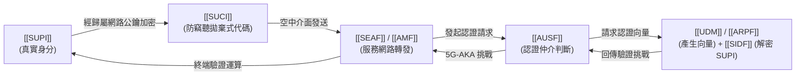

# 5G 安全架構全景導航 (5G Security Architecture Overview)

> **閱讀指引**：本篇為進入 5G 網路安全領域的第一站，旨在用最宏觀的視角，幫助初學者快速建立 5G 安全架構的心智模型（Mental Model）。

---

## 💡 為什麼 5G 安全需要全新設計？（痛點與動機）

在 2G/3G/4G 時代，行動網路的安全架構存在幾個廣為人知的安全隱患：
1. **身分曝露風險（IMSI Catcher / 偽基站）**：
   - 4G 以前，終端（UE）在初始開機連線時，會將使用者的全球唯一身分識別碼（IMSI）以**明文（Cleartext）**形式在無線電波中廣播。
   - 攻擊者只要架設一台發射功率高於周邊合法基地台的設備（IMSI Catcher），手機就會主動接入並交出明文 IMSI，攻擊者即可在該地區長期追蹤用戶 [講義: 5G安全_TS33501-Week4.pdf, p.6–7]。
2. **對服務網路（Serving Network）過度信任**：
   - 在 4G 漫遊情境下，若拜訪的服務網路聲稱「用戶已通過認證」，使用者的老家網路（Home Network）無法獨立確認該終端是否真的在該拜訪地，容易受到服務網路欺騙或假冒。

> **5G 的解法**：  
> 引入了 **[[SUPI]] 與 [[SUCI]]** 的公鑰加密隱蔽機制，解決這個「修了三十年」的偽基站明文監聽問題 [講義: 5G安全_TS33501-Week4.pdf, p.6–7]；同時在核心網設計了 **[[AUSF]] 與 [[SEAF]]** 的雙層認證分離架構，實現真正的雙向嚴格相互認證。

---

## 🏛️ 5G 五大安全網域 (5G Security Domains)

依據 **3GPP TS 33.501 Clause 5.1**，5G 網路安全劃分為以下五大維度：

```mermaid
flowchart TB
    subgraph UserDomain["1. 使用者網域 (User Domain)"]
        UE["UE / USIM<br>(終端設備與安全模組)"]
    end

    subgraph AccessDomain["2. 網路存取安全 (Network Access Security)"]
        gNB["gNB (5G 基站)<br>無線介面加密與完整性保護"]
    end

    subgraph NetworkDomain["3. 網路網域安全 (Network Domain Security)"]
        AMF["AMF / SEAF<br>(服務網路)"]
        AUSF["AUSF<br>(認證核心)"]
        UDM["UDM / SIDF / ARPF<br>(歸屬網路)"]
    end

    subgraph AppDomain["4. 應用網域安全 (Application Domain)"]
        App["終端與第三方應用服務通訊安全"]
    end

    subgraph SBA["5. 服務化架構安全 (SBA Security)"]
        OAuth["OAuth 2.0 / mTLS<br>微服務網元間 API 授權與加密"]
    end

    UE <-->|無線介面安全 (AS/NAS)| gNB
    gNB <-->|N2/N3 安全傳輸| AMF
    AMF <-->|SBA API 服務化匯流排| AUSF
    AUSF <-->|SBA API 服務化匯流排| UDM
```

1. **網路存取安全 (Network Access Security)**：確保 UE 能安全存取 5G 網路，包含無線電介面（Air Interface）的資料加密與完整性防竄改。
2. **網路網域安全 (Network Domain Security)**：確保網元（NF）之間在核心網內交換信令與資料的安全（包括微服務化匯流排 SBA 的傳輸安全）。
3. **使用者網域安全 (User Domain Security)**：確保使用者端模組（USIM）與設備（ME）之間的相互驗證與授權。
4. **應用網域安全 (Application Domain Security)**：終端與營運商或外部第三方應用伺服器之間的端到端通訊安全。
5. **服務化架構安全 (Service Based Architecture, SBA Security)**：5G 核心網採用雲原生微服務架構，NF 之間透過 HTTP/2、JSON、TLS 與 OAuth 2.0 進行安全授權。

---

## 🔑 5G 認證三部曲：核心概念串聯

在整個 5G 安全架構中，最核心的骨幹就是**身分隱私**與**主要認證（Primary Authentication）**：



- **第一步：保護真身** $\to$ UE 利用內建之 Home Network 公鑰將 `[[SUPI]]` 加密為 `[[SUCI]]`，偽基站就算截獲也無法破解。
- **第二步：驗明正身** $\to$ `[[AUSF]]` 與 `[[UDM]]` 進行雙向挑戰，執行 `[[5G-AKA]]` 或 `[[EAP-AKA-prime]]` 協定。
- **第三步：衍生金鑰** $\to$ 認證成功後，基於 `[[Key-Hierarchy]]` 逐層推導出保護信令（NAS）與使用者數據（AS/UP）的高強度會話金鑰。
- **第四步：啟用保護** $\to$ 透過 [[Security-Mode-Command]] 先後啟用 NAS 與 AS 安全（分層差異見 [[NAS-vs-AS-Security]]），由 [[Air-Interface-Security]] 在 PDCP 層對空中電波加密與完整性保護；使用者資料的完整性則依政策啟用 [[User-Plane-Integrity]]。
- **仍存在的空窗** $\to$ 認證完成**之前**的廣播與初始訊息無法保護，這是 [[False-Base-Station-Defenses]] 要處理的偽基地台攻擊面。

---

## 📚 規範對應與學習路徑

- **核心規範依據**：
  - 3GPP TS 33.501 Rel-18:
    - Clause 4: 5G 安全架構總覽 (Security Architecture)
    - Clause 5: 安全要求與威脅模型 (Security Requirements)
    - Clause 6.1: 主要認證機制 (Primary Authentication)
    - Clause 6.12: 用戶身分隱私保護 (User Identity Confidentiality)
- **建議探索順序**：
  1. 理解身分保護：`[[SUPI]]` $\to$ `[[SUCI]]` $\to$ `[[SIDF]]`
  2. 理解網元職責：`[[AUSF]]` $\to$ `[[UDM]]` $\to$ `[[SEAF]]`
  3. 研讀認證流程：`[[5G-AKA]]` 信令與 Mermaid 時序圖
  4. 深入金鑰推導：`[[Key-Hierarchy]]`
  5. 空中介面保護：[[Security-Mode-Command]] $\to$ [[Air-Interface-Security]] $\to$ [[User-Plane-Integrity]]
  6. 攻擊面與防禦：[[False-Base-Station-Defenses]]

---

## 📚 參考文獻與條款溯源 (References & Traceability)
- 3GPP TS 33.501 Rel-18: §4 (Overview), §5 (Security Requirements), §6 (Security Procedures)
