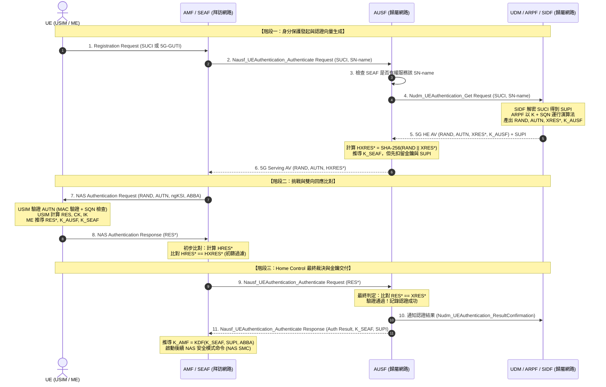
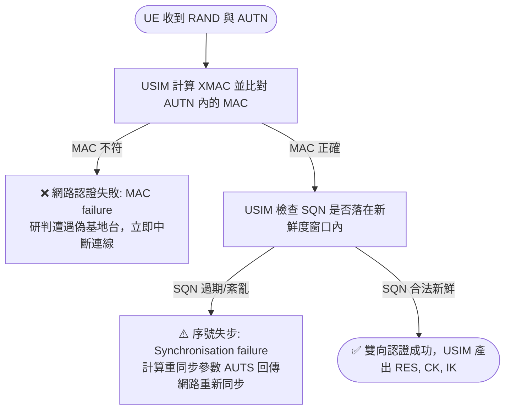

# 5G 主要認證流程 (5G Primary Authentication - 5G AKA)

> **觸發時機**：使用者設備（UE）初始註冊（Initial Registration）、連線狀態重啟、定期金鑰重新整理或安全上下文失效時。  
> **主要目標**：實現 UE 與 5G 核心網路之間的**雙向相互認證（Mutual Authentication）**，確立歸屬網路對服務網路的授權控制（Home Control），並推導出拜訪網路的錨點金鑰 $K_{SEAF}$，為後續 NAS 與 AS 層的安全保護奠定基礎 [3GPP TS 33.501 Rel-18 §6.1.3.2]。

---

## 🎯 流程核心觀念導讀

### 生活化比喻：跨國海關、母國戶政司與防偽護照
想像你出國旅行：
1. **隱蔽護照（[[SUCI]]）**：你拿出了一本動態產生的隱蔽旅行證件，海關（拜訪網路 [[SEAF]]）只看得出你的國籍，但不知道你的真實身分。
2. **母國核發考卷（認證向量 AV）**：海關向你母國的移民署（[[AUSF]]/[[UDM]]）索取考題。母國給了一份試卷 $(RAND, AUTN)$ 和答案的雜湊遮罩 $(HXRES^*)$，但把真實答案 $(XRES^*)$ 藏在自己保險庫裡。
3. **雙向暗號對決**：
   - **你認證海關（網路認證）**：你拿著試卷裡的 $AUTN$ 與你的 SIM 卡比對，確認出題者確實持有只有你和母國知道的家傳密碼（長期金鑰 $K$），且試卷編號（$SQN$）沒有過期——你確認這家海關不是山寨的。
   - **海關初篩與母國裁決（用戶認證）**：你寫出答案 $RES^*$ 交給海關。海關用遮罩快速看一眼（計算 $HRES^*$ 比對 $HXRES^*$），確定你不是瞎猜的；但海關**沒有資格宣布你通關**，必須把考卷送回母國。
4. **母國最終判定（Home Control）**：母國 AUSF 比對真假，大印一蓋宣布合格，並把你的真實身分（[[SUPI]]）與通關令牌（$K_{SEAF}$）交付海關。

---

## 🔄 Mermaid 時序信令圖 (Signaling Call Flow)

---

## 📝 信令步驟詳解 (Step-by-Step Breakdown)

### 階段一：身分保護發起與認證向量生成（步驟 1–6）
1. **UE $\to$ SEAF (`Registration Request`)**：  
   終端透過空中介面發送註冊請求。若終端尚未具備合法有效之安全上下文，身分識別碼欄位**強制攜帶以 ECIES 混合加密之 [[SUCI]]**，禁止傳送明文 [[SUPI]] [TS 33.501 Rel-18 §6.12.2; 講義: 5G安全_TS33501-Week4.pdf, p.16]。
2. **SEAF $\to$ AUSF (`Nausf_UEAuthentication_Authenticate Request`)**：  
   SEAF 代表拜訪網路向歸屬網路發起服務調用，訊息中除了攜帶終端送達之 SUCI 外，**必須附上服務網路名稱 $SN\text{-}name$**（格式為 `5G:mnc<MNC>.mcc<MCC>.3gppnetwork.org`）[TS 33.501 Rel-18 §6.1.1.4, §6.1.3.2]。
3. **AUSF 檢核服務網路合法性**：  
   AUSF 檢查發出請求的 SEAF 是否有權使用其聲稱的 $SN\text{-}name$；若無權，回覆 "serving network not authorized"，防止惡意拜訪網路偽冒他網身分 [TS 33.501 Rel-18 §6.1.2; 講義: 5G安全_TS33501-Week4.pdf, p.16]。
4. **AUSF $\to$ UDM (`Nudm_UEAuthentication_Get Request`)**：  
   AUSF 將 SUCI 與 $SN\text{-}name$ 轉發給 UDM。
5. **UDM/SIDF/ARPF 內部運算與回傳 5G HE AV**：  
   - [[SIDF]] 以歸屬網路私鑰解密 SUCI，還原出真實的 [[SUPI]]。
   - UDM 查詢訂閱資料庫，確認用戶簽約方案並選定認證方法為 5G-AKA [TS 33.501 Rel-18 §6.1.2]。
   - [[ARPF]] 讀取根金鑰 $K$ 與目前序號 $SQN$，執行 MILENAGE 或 TUAK 密碼函式，產出核心參數：$RAND$、認證權杖 $AUTN$、期望回應值 $XRES$、加密金鑰 $CK$、完整性金鑰 $IK$ [TS 35.206]。
   - ARPF 結合 $CK \parallel IK$、$SN\text{-}name$、$RAND$ 與 $XRES$，藉由 3GPP 通用 KDF（TS 33.501 Annex A.4, $FC=0x6B$）推導出 5G 專屬的期望回應值 **$XRES^*$**。
   - 藉由 KDF（TS 33.501 Annex A.2, $FC=0x6A$）以 $CK \parallel IK$、$SN\text{-}name$ 與 $SQN \oplus AK$ 推導出歸屬網路金鑰 **$K_{AUSF}$**。
   - UDM 回傳 5G 歸屬環境認證向量 **5G HE AV：$(RAND, AUTN, XRES^*, K_{AUSF})$** 與解密後的 $SUPI$ [TS 33.501 Rel-18 §6.1.3.2]。
   > **安全要點**：$CK$ 與 $IK$ 絕不離開歸屬網路，拜訪網路永遠接觸不到原始對稱金鑰。
6. **AUSF 轉換認證向量並扣留關鍵憑證**：  
   - AUSF 保存 $XRES^*$，並執行 SHA-256 雜湊與截斷運算（TS 33.501 Annex A.5）：
     $$HXRES^* = \text{SHA-256}(RAND \parallel XRES^*)[128..255]$$
   - 藉由 KDF（TS 33.501 Annex A.6, $FC=0x6C$）以 $K_{AUSF}$ 與 $SN\text{-}name$ 推導出拜訪網路錨點金鑰 **$K_{SEAF}$**。
   - AUSF **扣留 $XRES^*$、$K_{SEAF}$ 與 $SUPI$ 不發**，僅將 5G 服務環境認證向量 **5G Serving AV：$(RAND, AUTN, HXRES^*)$** 提供給 SEAF [TS 33.501 Rel-18 §6.1.3.2]。

---

### 階段二：挑戰與雙向回應比對（步驟 7–10）
7. **SEAF $\to$ UE (`NAS Authentication Request`)**：  
   SEAF 透過空中介面向 UE 發送認證挑戰，包含：亂數挑戰 $RAND$、網路認證權杖 $AUTN$、金鑰組識別碼 $ngKSI$ 與防架構降級參數 $ABBA$ [TS 33.501 Rel-18 §6.1.3.2]。
8. **UE / USIM 內部驗證與運算**：  
   - 終端將 $(RAND, AUTN)$ 送入實體防竄改的 [[USIM]] 晶片。
   - **驗證一（網路真偽）**：USIM 執行內部函式計算 $XMAC$，比對 $AUTN$ 中的 $MAC$。若吻合，證明出題者必定知曉根金鑰 $K$，確立「網路端身分合法」。
   - **驗證二（防重送）**：USIM 檢查解密出的 $SQN$ 是否在合理的新鮮度窗口內。若通過，確認此挑戰非先前錄製之重放封包。
   - USIM 產出 $RES$、$CK$ 與 $IK$，將其回傳給手機終端處理器（ME）。
   - ME 依照 Annex A.4 算式以 $CK \parallel IK$、$SN\text{-}name$、$RAND$ 算得終端回應值 **$RES^*$**；並同步推導出 $K_{AUSF}$ 與 $K_{SEAF}$。
9. **UE $\to$ SEAF (`NAS Authentication Response`)**：  
   UE 僅回傳計算結果 **$RES^*$**。**UE 永不在網路上傳送任何密鑰** [講義: 5G安全_TS33501-Week4.pdf, p.17]。
10. **SEAF 初步比對（Efficiency Check）**：  
    - SEAF 計算單向雜湊：
      $$HRES^* = \text{SHA-256}(RAND \parallel RES^*)[128..255]$$
    - 比對 $HRES^* == HXRES^*$。相符則 SEAF「從服務網路角度」視為認證成功；不符則視為失敗，但**仍須繼續步驟 11 把 $RES^*$ 送給 AUSF**，收到 AUSF 回覆後才拒絕 UE（用 SUCI 時）或發起 Identification 程序（用 5G-GUTI 時）[TS 33.501 Rel-18 §6.1.3.2 step 9, §6.1.3.2.2]。

    > [!WARNING]
    > **講義與規格分歧**：講義 p.17 寫「若不符，SEAF 可立刻拒絕。這是效率設計，不是最終判定」。規格 §6.1.3.2.2 則明訂 "The SEAF shall proceed with step 10"（即本頁步驟 11），失敗時也要等 AUSF 回覆。講義「SEAF 的比對是效率、AUSF 的比對是權威」的總結仍可用來理解兩者分工，但「省下跨網往返」並不成立。（2026-11-11 Claude Code 查核補記）

---

### 階段三：Home Control 最終裁決與金鑰交付（步驟 11–14）
11. **SEAF $\to$ AUSF (`Nausf_UEAuthentication_Authenticate Request`)**：  
    SEAF 通過初篩後，將原始的 $RES^*$ 原封不動送至歸屬網路 AUSF [TS 33.501 Rel-18 §6.1.3.2]。
12. **AUSF 權威最終判定**：  
    AUSF 將 $RES^*$ 與保險庫中的 $XRES^*$ 執行完全位元比對，並檢查該認證向量是否仍在有效期內。**只有歸屬網路 AUSF 比對一致，本次認證方宣告正式成功**。
13. **AUSF 登錄並交付金鑰**：  
    - AUSF 以 `Nudm_UEAuthentication_ResultConfirmation` 將認證結果（SUPI、時間戳、認證類型、SN-name）通知 UDM 儲存；UDM 之後收到 AMF 的 `Nudm_UECM_Registration` 時可據此比對 [TS 33.501 Rel-18 §6.1.4.1a]，實現歸屬網路控制（防止拜訪網路虛報連線計費）[TS 33.501 Rel-18 §6.1.4]。
    - AUSF 向 SEAF 回傳成功狀態，並**正式釋放 $K_{SEAF}$ 與真實身分 $SUPI$**。拜訪網路此時才正式取得用戶資訊與後續防護的主金鑰。
14. **SEAF 推導 $K_{AMF}$**：  
    SEAF 依照 Annex A.7 結合 $K_{SEAF}$、$SUPI$ 與 $ABBA$ 參數，推導出行動管理金鑰 $K_{AMF}$，並發動後續的 NAS 安全模式命令（NAS SMC）[TS 33.501 Rel-18 §6.2.2, §6.7.2]。

---

## 🔍 AUTN 結構與 UE 端檢核機制

網路發給 UE 的認證權杖格式定義如下 [TS 33.102; TS 33.501 §6.1.3.2; 講義: 5G安全_TS33501-Week4.pdf, p.17]：
$$AUTN = ( SQN \oplus AK ) \parallel AMF \parallel MAC$$

| 欄位名稱 | 長度 | 技術作用與密碼機制 |
|---|---|---|
| **$SQN \oplus AK$** | 48 bits (6 bytes) | **序號與匿名金鑰**：$SQN$ 由歸屬網路嚴格遞增維護，提供抗重送保證；以匿名金鑰 $AK = f5_K(RAND)$ 進行互斥或（XOR）混淆，防止竊聽者依序號分析用戶的通訊頻率或出沒週期。 |
| **$AMF$** | 16 bits (2 bytes) | **認證管理欄位**（Authentication Management Field）：此處 AMF 為參數名，與網元 AMF 完全無關。**其第 0 位元（Separation bit）在 5G 強制設為 `1`**，用於嚴格區分 5G 與 2G/3G/4G 舊世代的認證向量，防範跨世代跨網認證向量轉移反彈攻擊。 |
| **$MAC$** | 64 bits (8 bytes) | **訊息認證碼**：由 $f1_K(SQN \parallel RAND \parallel AMF)$ 算出。UE 的 USIM 驗算此值，唯有擁有合法金鑰 $K$ 的歸屬網路才算得出正確的 MAC。 |

### UE 端的兩道檢查與兩種失敗應對

> [!WARNING] 學術界指出的 AKA 可連結性隱患 (Linkability Attack)
> 多篇學術論文（2018–2021）指出：由於 `MAC failure` 與 `Synchronisation failure` 屬於兩種不同的錯誤碼，攻擊者可向特定目標重放先前側錄的 $(RAND, AUTN)$。若該手機回覆同步失敗（因 MAC 通過但序號重複），其他手機則會回覆 MAC 失敗。攻擊者藉由觀測錯誤訊息種類，仍能探測特定裝置是否在場。這意味著 **SUCI 保護了「你是誰」，但沒有完全保護「你是不是同一個人」**。此問題自 3G 起就存在，5G-AKA 也未完全解決，因為修正需要改動 USIM 的行為，**換卡成本極高**；多篇論文提出過改良方案，標準化仍在討論 [講義: 5G安全_TS33501-Week4.pdf, p.18, 29]。
> （註：Basin 等人 ACM CCS 2018 的貢獻是以 Tamarin 對 5G-AKA 做**形式化驗證**，不是可連結性攻擊；舊版本頁面誤植，2026-11-11 Claude Code 修正 [講義: 5G安全_TS33501-Week4.pdf, p.29]。）

---

## 🔑 三階比對架構：XRES*、HXRES*、RES* 的存在理由

| 數值 | 誰計算 / 誰持有 | 計算公式與來源 | 安全哲學與存在理由 [講義 p.18] |
|---|---|---|---|
| **$XRES^*$** | ARPF 計算，由 **AUSF** 獨家持有 | $KDF(CK \parallel IK, SN\text{-}name, RAND, XRES)$ [TS 33.501 Annex A.4] | **唯一正確解答（權威）**。只有歸屬網路掌握。拜訪網路拿不到此值，因此**絕對無法無中生有、自行偽造認證成功訊令**。 |
| **$HXRES^*$** | 由 **AUSF** 計算，交付給 **SEAF** | $\text{SHA-256}(RAND \parallel XRES^*)[128..255]$ [TS 33.501 Annex A.5] | **單向防窺初篩值（效率）**。SEAF 可拿來比對終端回應，但因 SHA-256 的不可逆性，SEAF 無法從中推算 $XRES^*$。讓拜訪網路先得出「從服務網路角度」的判定；但依規格，即使不符仍須把 RES* 轉給 AUSF（見步驟 10 的 WARNING）。 |
| **$RES^*$** | 由 **UE** 計算，經 SEAF 送至 AUSF | $KDF(CK \parallel IK, SN\text{-}name, RAND, RES)$ [TS 33.501 Annex A.4] | **持有長期金鑰 $K$ 的證明**。由於推導時強制綁入 $SN\text{-}name$，該回應僅在目前的拜訪網路有效，防止被轉錄拿到其他網路重用。 |

> **一句話總結核心價值**：  
> **「SEAF 的比對是效率，AUSF 的比對是權威」**。少了 AUSF 最終比對，5G 就會退回 4G 漫遊可被拜訪網肆意詐欺的脆弱模型。

---

## 🛡️ 安全防禦保證總結

1. **雙向認證保證**：UE 驗證網路（靠 AUTN/MAC），核心網驗證 UE（靠 RES*/XRES*），徹底杜絕 2G 時代的單向欺騙。
2. **防重送保證（Replay Attack Defense）**：每次認證具備全新的 128-bit $RAND$，配合單向遞增的 $SQN$ 序號窗口，任何側錄訊息均無法再次通過驗證。
3. **服務網路身分綁定（SN-name Binding）**：$SN\text{-}name$ 深度綁入 $XRES^*$、$RES^*$、$K_{AUSF}$ 與 $K_{SEAF}$。拜訪網路無從冒名頂替，亦無法挪用其他業者的認證信令。
4. **歸屬網路全面控制（Home Control）**：所有漫遊認證結果必須回傳歸屬網路登錄，電信商對用戶在全球的接入狀態擁有 100% 知情權與最終裁決權。

---

## 🔗 關聯概念與流程
- 關聯實體：[[SEAF]], [[AUSF]], [[UDM]], [[ARPF]], [[SIDF]]
- 涉及概念：[[SUPI]], [[SUCI]], [[Key-Hierarchy]], [[EAP-AKA-prime]]
- 對比分析：[[4G-vs-5G-AKA]]
- 接續流程：[[Security-Mode-Command]]（NAS / AS 安全模式命令啟動）

---

## 📚 參考文獻與條款溯源 (References & Traceability)
- 3GPP TS 33.501 Rel-18:
  - §6.1.1 (Authentication framework & Serving network name)
  - §6.1.2 (Initiation of authentication and selection of authentication method)
  - §6.1.3.2 (5G AKA authentication procedure)
  - §6.1.3.3 (Synchronization failure or MAC failure)
  - §6.1.4 (Linking increased home control to subsequent procedures)
  - Annex A.2 ($K_{AUSF}$ derivation function, $FC=0x6A$)
  - Annex A.4 ($RES^* / XRES^*$ derivation function, $FC=0x6B$)
  - Annex A.5 ($HRES^* / HXRES^*$ derivation function)
  - Annex A.6 ($K_{SEAF}$ derivation function, $FC=0x6C$)
  - Annex A.7 ($K_{AMF}$ derivation function, $FC=0x6D$)
- 3GPP TS 33.102: §6.3 (Authentication and key agreement in 3G)
- 3GPP TS 35.206: (MILENAGE Algorithm Set Specification)
- 課程講義來源: `raw/lectures/5G安全_TS33501-Week4.pdf` (第 4 章 p.15–19)
