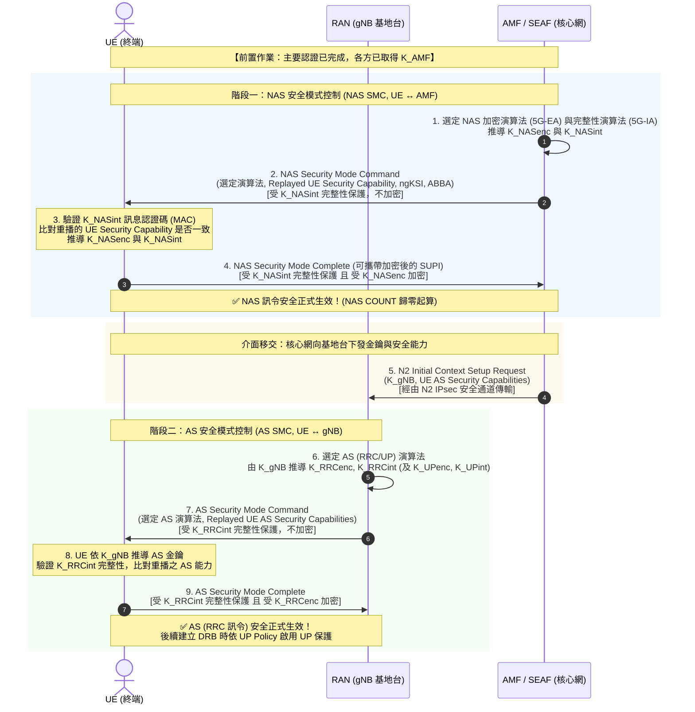

# 安全模式控制程序 (Security Mode Command Procedure - NAS & AS SMC)

> **觸發時機**：在完成主要認證（[[5G-AKA]] 或 [[EAP-AKA-prime]]）並推導出金鑰後觸發；亦可在安全上下文變更、演算法切換或換手時重新發動。  
> **主要目標**：在終端（UE）與網路之間協商並鎖定密碼演算法（加密演算法 NEA 與完整性演算法 NIA），啟動對稱密鑰保護，正式由「明文階段」轉移至「安全保護階段」[3GPP TS 33.501 Rel-18 §6.7.2, §6.7.4]。

---

## 🎯 流程核心觀念導讀

### 生活化比喻：在公開廣播中約定軍用密碼本
想像特戰隊員（UE）剛進入敵後戰區，正與大本營（核心網 [[AMF]]）和前線碉堡（基地台 [[gNB]]）通聯：
1. **公開宣稱能力（初始明文）**：隊員用明文無線電喊話：「我身上的密碼機支援 1 號、2 號和 3 號密碼演算法。」（此時訊息可能被敵軍干擾或掉包）。
2. **指揮官挑選並加蓋鋼印（SMC 訊息）**：指揮官從兩人都支援的演算法中挑出最高等級的 2 號密碼，並在指令上**原封不動重播**隊員剛才喊出的能力清單，最後蓋上只有兩人能驗證的**防偽鋼印（完整性金鑰 MAC）**，但**整張紙仍未加密**。
3. **先看鋼印再看密碼（先整後密）**：隊員收到後，先拿手上的防偽私章確認鋼印為真（證明指揮官確實持有金鑰），接著檢查重播的密碼機清單有沒有被敵軍竄改。若完全相符，隊員戴上 2 號加密模組，回傳一封**「已蓋印且已加密」**的確認函。
4. **兩階段分工**：
   - **第一階段（NAS SMC）**：UE 與核心網 AMF 建立核心訊令防護。
   - **第二階段（AS SMC）**：UE 與基地台 gNB 建立無線電波防護。

---

## 🔄 Mermaid 時序信令圖 (Signaling Call Flow)

---

## 📝 信令步驟詳解 (Step-by-Step Breakdown)

### 階段一：NAS 安全模式控制（NAS SMC，步驟 1–4）
1. **AMF 挑選演算法**：  
   AMF 檢視 UE 在初始 `Registration Request` 中宣告的 UE 安全能力（UE Security Capability），並對照本地營運商設定之演算法優先序清單，挑出優先度最高的 NAS 加密演算法（如 `128-NEA2`）與完整性演算法（如 `128-NIA2`）[TS 33.501 Rel-18 §6.7.2]。AMF 隨即根據 [[Key-Hierarchy]] Annex A.8 推導出 $K_{NASenc}$ 與 $K_{NASint}$。
2. **AMF 發送 `NAS Security Mode Command`**：  
   此訊息包含：選定的 NAS 演算法識別碼、金鑰組識別碼 $ngKSI$、跨架構防降級參數 $ABBA$，以及**原封不動重播收到的 UE Security Capability** [TS 33.501 Rel-18 §6.7.2]。  
   > ⚠️ **關鍵設計**：**此訊息僅做完整性保護（以 $K_{NASint}$ 計算 MAC），絕不加密**。因為終端此時尚未啟用解密模組，必須先透過完整性驗證確認指令無誤後，才能安全啟用密鑰。
3. **UE 驗證與金鑰啟用**：  
   - UE 使用 $K_{NASint}$ 驗算 MAC。若驗證失敗，立即中止流程（研判遭竄改）。
   - **防降級檢查**：比對訊息中重播的 security capability 與自己最初送出的清單是否 100% 吻合。若發現任何差異，代表通訊遭中間人掉包降級，立即拒絕 [講義 p.12, 20]。
   - 檢查通過後，UE 本地啟用 $K_{NASenc}$ 與 $K_{NASint}$。
4. **UE 回覆 `NAS Security Mode Complete`**：  
   UE 回覆完成確認。**此訊息必須同時受完整性保護與加密**。若 UE 最初是以 [[SUCI]] 發起註冊，UE 可在此受加密保護的訊息中安全傳送真實的 [[SUPI]] [TS 33.501 Rel-18 §6.7.2; 講義: 5G安全_TS33501-Week4.pdf, p.24]。隨後，上行與下行 $\text{NAS COUNT}$ 歸零起算。

---

### 階段二：AS 安全模式控制（AS SMC，步驟 5–9）
5. **N2 介面金鑰交付**：  
   AMF 藉由 $K_{AMF}$ 與當時之 $\text{Uplink NAS COUNT}$ 推導出基地台根金鑰 $K_{gNB}$（TS 33.501 Annex A.9），並透過 N2 介面（由 NDS/IP IPsec 保護）將 $K_{gNB}$ 與 UE 的 AS 安全能力交付給 gNB [TS 33.501 Rel-18 §6.2.2.1, §6.7.4]。
6. **gNB 挑選 AS 演算法**：  
   gNB 獨立挑選 RRC 與使用者平面（UP）的加密與完整性演算法，並由 $K_{gNB}$ 推導出四把葉子金鑰：$K_{RRCenc}$、$K_{RRCint}$、$K_{UPenc}$、$K_{UPint}$。
7. **gNB 發送 `AS Security Mode Command`**：  
   透過無線空中介面向 UE 發送 RRC 指令，包含選定的演算法與重播的 UE AS 安全能力。同樣**僅受 $K_{RRCint}$ 完整性保護，不加密** [TS 33.501 Rel-18 §6.7.4; 講義 p.16]。
8. **UE 驗證 AS SMC**：  
   UE 依 $K_{gNB}$ 導出 AS 金鑰，驗算 $K_{RRCint}$ 完整性標籤，確認重播能力無誤。
9. **UE 回覆 `AS Security Mode Complete`**：  
   此訊息同時受 $K_{RRCint}$ 完整性保護與 $K_{RRCenc}$ 加密。自此，所有空中介面 RRC 訊令皆受到完整加密與防竄改保護。使用者平面（DRB）隨後在建立 PDU Session 時依 [[User-Plane-Integrity]] 策略啟用 [TS 33.501 Rel-18 §6.6]。

---

## 🛡️ 安全機制驗證與威脅防禦

### 1. 徹底擊潰 Bidding-down（演算法降級攻擊）的三道防線
若沒有 SMC 保護，中間人可輕易在空中竄改 UE 的初始宣告，謊稱手機只支援空加密（`NEA0/NIA0`），誘使網路以無保護明文傳輸 [講義 p.20, 25]。3GPP 建立了三道防線徹底阻斷此威脅：
1. **能力原封重播（Capability Replay）**：SMC 內強制重播原始能力清單，並受完整性金鑰保護。攻擊者無法修改受保護的 SMC，UE 一比對即可揪出竄改。
2. **選擇權在網路端（Network-Controlled）**：演算法優先序由營運商設定決定，UE 只能申報「支援哪些」，無權要求「使用弱演算法」。
3. **ABBA 參數防架構降級**：將指示網路安全特性的 $ABBA$ 參數直接作為推導 $K_{AMF}$ 的輸入，若中間人謊報舊版本架構，金鑰失配將直接導致通訊失敗。

### 2. 為什麼 SMC 必須「先做完整性、暫不加密」？
UE 必須能在**還沒有解密能力之前**，就先驗證這則訊息沒有被竄改；若順序反過來，攻擊者就能改掉演算法選擇本身 [講義: 5G空中介面安全-Week5.pdf, p.16; 5G安全_TS33501-Week4.pdf, p.24]。

---

## 🔗 關聯概念與流程
- 前置流程：[[5G-AKA]]
- 金鑰體系：[[Key-Hierarchy]]
- 空中介面：[[Air-Interface-Security]]
- 使用者平面：[[User-Plane-Integrity]]
- 對比架構：[[NAS-vs-AS-Security]]

---

## 📚 參考文獻與條款溯源 (References & Traceability)
- 3GPP TS 33.501 Rel-18:
  - §6.7.2 (NAS security mode command procedure)
  - §6.7.4 (AS security mode command procedure)
  - §6.4 (NAS security mechanisms)
  - §6.5 (RRC security mechanisms)
  - Annex A.8 (Algorithm key derivation functions)
  - Annex D (Crypto algorithms)
- 3GPP TS 38.331: (NR Radio Resource Control (RRC) protocol specification)
- 課程講義來源: `raw/lectures/5G空中介面安全-Week5.pdf` (第 2 章 p.12、第 3 章 p.15–16、第 4 章 p.20) 與 `5G安全_TS33501-Week4.pdf` (第 6 章 p.23–25)
